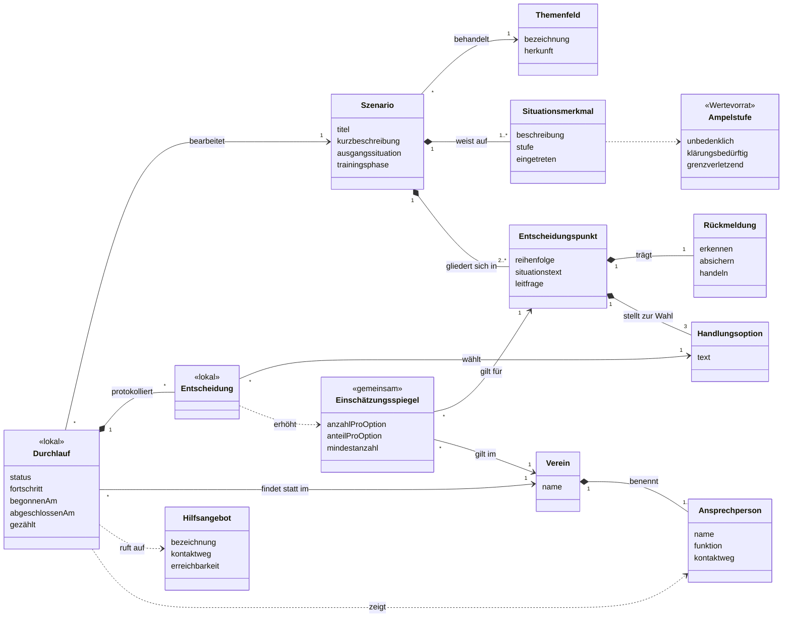

# Modelle

Teil der [Projektdokumentation](projektdokumentation.md) zur Bachelorarbeit von Jonathan Sommerer, finale Fassung vom 27.10.2026.

---

## 10 Modelle

### 10.1 Ablauf (Abb. 1)

UML-Aktivitätsdiagramm des Szenariodurchlaufs. Die Rückführung auf den Verzweigungsknoten oberhalb des Entscheidungspunkts bildet die Wiederholung ab. Von den Handlungsoptionen geht keine eigene Kante aus: Der Fortgang hängt nicht an der Wahl (F05). Zwei Abweichungen: Unterbrechung mit Speichern (F12), Hinweis bei zu wenigen Entscheidungen anderer (F11). Die Rückmeldung ist ein optionaler Seitenzweig (F06).

### 10.2 Konzeptionelles Klassendiagramm (Abb. 2, Anhang 7)

13 Klassen in drei Bereichen: **Inhalt** (redaktionell gepflegt), **Nutzung** (entsteht beim Bearbeiten) und **Vereinskontext** (beim Einsatz hinterlegt). Keine Methoden, Sichtbarkeiten oder Datentypen; Abb. 2 zeigt die Klassen ohne Attribute. Die Trennung des Vereinskontexts geht auf NF13 zurück. Absichtlich gibt es keine Klasse für eine nutzende Person.

Der Quelltext liegt auch als [`klassendiagramm.mmd`](klassendiagramm.mmd) vor.

| Klasse | Bereich | Bedeutung | Attribute | Anforderung |
|---|---|---|---|---|
| Themenfeld | Inhalt | Risikofeld, dem ein Szenario zugeordnet ist | bezeichnung, herkunft | F01, F02 |
| Szenario | Inhalt | Zusammenhängende Situationsfolge aus dem Trainingsalltag | titel, kurzbeschreibung, ausgangssituation, trainingsphase | F01, F02, F03, F04, NF09 |
| Situationsmerkmal | Inhalt | Einzelnes Merkmal des Szenarios mit seiner Einstufung | beschreibung, stufe, eingetreten | F07 |
| Entscheidungspunkt | Inhalt | Stelle im Szenario, an der die Situation anhält | reihenfolge, situationstext, leitfrage | F03, F05 |
| Handlungsoption | Inhalt | Eine der drei angebotenen Reaktionsmöglichkeiten | text | F03, F13 |
| Ampelstufe «Wertevorrat» | Inhalt | Wertevorrat: unbedenklich, klärungsbedürftig, grenzverletzend | – | F07 |
| Rückmeldung | Inhalt | Fachliche Einordnung eines Entscheidungspunkts | erkennen, absichern, handeln | F06 |
| Durchlauf «lokal» | Nutzung | Eine Bearbeitung eines Szenarios, ausschließlich auf dem Endgerät gehalten | status, fortschritt, begonnenAm, abgeschlossenAm, gezählt | F12, F13, F14, NF04, NF05 |
| Entscheidung «lokal» | Nutzung | Die an einem Entscheidungspunkt gewählte Option. Erhöht beim Abschluss den Zähler, ohne selbst übertragen zu werden. | – | F10, NF04, NF05 |
| Einschätzungsspiegel «gemeinsam» | Nutzung | Vereinsweiter Zähler je Entscheidungspunkt und Handlungsoption | anzahlProOption, anteilProOption, mindestanzahl | F10, F11 |
| Hilfsangebot | Vereinskontext | Überregionale, vereinsunabhängige Beratungsstelle | bezeichnung, kontaktweg, erreichbarkeit | F09 |
| Ansprechperson | Vereinskontext | Vereinsintern benannte Person mit Meldeweg | name, funktion, kontaktweg | F08 |
| Verein | Vereinskontext | Einsatzkontext des Prototyps und Bezugsgruppe der Anteilswerte | name | F10, NF13 |

F15 ist bewusst nicht im Modell: Pflegbarkeit ist eine Systemfunktion, kein fachlicher Gegenstand.

### 10.3 Vom Entwurf zum Diagramm

Der Entwurf vom 27.08.2026 („Domänenmodell“) hatte 16 Klassen. Gestrichen wurden Nutzerprofil, Trainerteam sowie die Aufzählungen Groomingphase und Trainingsphase; neu ist Situationsmerkmal. Der Name folgt Glinz et al. (2024), die Klassendiagramme behandeln, aber nichts zum Domänenmodell schreiben.

- **Szenario:** Die Groomingphase ist weggefallen, die Trainingsphase ist keine eigene Klasse mehr, sondern ein Attribut. Neu ist die Ausgangssituation mit Altersgruppe, Ort und Vorgeschichte (F04).
- **Situationsmerkmal:** Neu. Die Ampelstufe hing im Entwurf an der Handlungsoption, also an der Wahl. Jetzt ordnet sie Merkmale der Situation ein, auch nicht eingetretene.
- **Handlungsoption:** Das Attribut einschätzung ist weg. Optionen werden nicht bewertet, und die Rückmeldung hängt nicht mehr an ihnen.
- **Rückmeldung:** Hing im Entwurf an der Handlungsoption, jetzt am Entscheidungspunkt. Sie beschreibt die Situation, nicht die Wahl.
- **Durchlauf:** Wurde im Entwurf von einem Nutzerprofil gestartet. Jetzt lebt er nur auf dem Gerät. Das Attribut gezählt verhindert, dass ein Durchlauf doppelt in den Zähler eingeht.
- **Entscheidung:** Bleibt jetzt lokal. Zeitpunkt und Reihenfolge werden nicht mehr festgehalten.
- **Einschätzungsspiegel:** Im Entwurf «berechnet» und auf ein Trainerteam bezogen. Jetzt «gemeinsam» für den ganzen Verein und mit Mindestanzahl (F11).
- **Ansprechperson:** Das Attribut eskalationsebene ist mit der Entscheidung vom 01.09. entfallen.
- **Verein:** Hatte im Entwurf Sparten und ein Trainerteam. Jetzt ist er nur noch die Bezugsgruppe für die Anteile.
