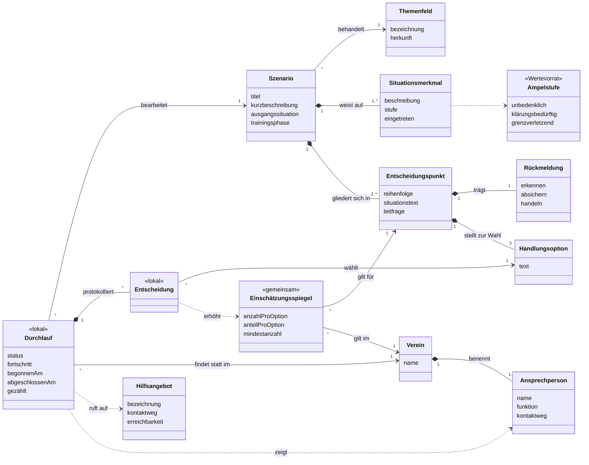

# Klassendiagramm (vormals Domänenmodell)

Ausgekoppelt aus der [Projektdokumentation](projektdokumentation.md). Stand 17.10.2026, Grundlage ist die Fassung vom 16.10.2026.

13 Klassen in drei Bereichen. Ersetzt das Domänenmodell vom 31.08. mit 16 Klassen (Nutzerprofil, Trainerteam, Groomingphase und Trainingsphase als Klassen sind entfallen, Situationsmerkmal ist neu).

**Inhalt** (redaktionell gepflegt): Szenario, Themenfeld, Situationsmerkmal, Ampelstufe «Wertevorrat», Entscheidungspunkt, Rückmeldung, Handlungsoption.

**Nutzung** (entsteht beim Bearbeiten): Durchlauf «lokal», Entscheidung «lokal», Einschätzungsspiegel «gemeinsam».

**Vereinskontext** (beim Einsatz hinterlegt): Verein, Ansprechperson, Hilfsangebot.

Die Trennung des Vereinskontexts von den Inhalten geht auf NF13 zurück und ist das Argument für die Übertragbarkeit auf andere Vereine.

| Klasse | Bereich | Bedeutung | Anforderung |
|---|---|---|---|
| Szenario | Inhalt | Zusammenhängende Situationsfolge aus dem Trainingsalltag | F01–F04, NF09 |
| Themenfeld | Inhalt | Risikofeld, dem ein Szenario zugeordnet ist | F01, F02 |
| Entscheidungspunkt | Inhalt | Stelle, an der die Situation anhält | F03, F05 |
| Handlungsoption | Inhalt | Eine der drei Reaktionsmöglichkeiten | F03, F13 |
| Rückmeldung | Inhalt | Fachliche Einordnung eines Entscheidungspunkts | F06 |
| Situationsmerkmal | Inhalt | Merkmal des Szenarios mit Einstufung | F07 |
| Ampelstufe | Inhalt | Wertevorrat der drei Stufen | F07 |
| Durchlauf | Nutzung | Eine Bearbeitung, nur auf dem Endgerät | F12, F13, F14, NF04, NF05 (in Anhang 8 steht noch F15) |
| Entscheidung | Nutzung | Gewählte Option; erhöht beim Abschluss den Zähler, ohne übertragen zu werden | F10, NF04, NF05 |
| Einschätzungsspiegel | Nutzung | Vereinsweiter Zähler je Entscheidungspunkt und Option | F10, F11 |
| Verein | Vereinskontext | Einsatzkontext und Bezugsgruppe der Anteilswerte | F10, NF13 |
| Ansprechperson | Vereinskontext | Vereinsintern benannte Person mit Meldeweg | F08 |
| Hilfsangebot | Vereinskontext | Überregionale, vereinsunabhängige Beratungsstelle | F09 |

F15 ist bewusst nicht im Modell: Die Pflegbarkeit ist eine Systemfunktion, kein fachlicher Gegenstand.
