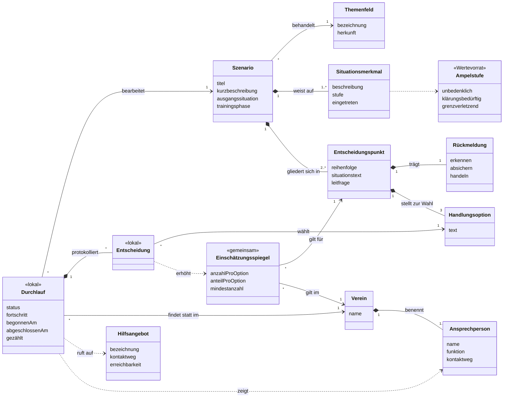

# Projektdokumentation Bachelorarbeit

**Konzeptionelle Entwicklung eines Prototyps zur Unterstützung bei der Implementierung von Präventionsmaßnahmen gegen sexualisierte Gewalt im Sportverein Post SV Nürnberg**

Jonathan Sommerer · DHfPG, Sport- und Gesundheitsinformatik · finale Fassung vom 27.10.2026

Website: [https://jonathansommerer.me/](https://jonathansommerer.me/) · Repository: [https://github.com/JontheMaster/Bachelor-Arbeit](https://github.com/JontheMaster/Bachelor-Arbeit)

Die Dokumentation fasst die abgeschlossene Arbeit zusammen und ergänzt sie um den Entstehungsprozess. Maßgeblich bleibt die Arbeit selbst.

---

## 1 Steckbrief

|  |  |
|---|---|
| **Titel** | Konzeptionelle Entwicklung eines Prototyps zur Unterstützung bei der Implementierung von Präventionsmaßnahmen gegen sexualisierte Gewalt im Sportverein Post SV Nürnberg |
| **Autor** | Jonathan Sommerer |
| **Hochschule** | Deutsche Hochschule für Prävention und Gesundheitsmanagement (DHfPG), Saarbrücken |
| **Studiengang** | Sport- und Gesundheitsinformatik, Bachelor of Science |
| **Betreuung** | Timo Engler (DHfPG), Jamie Killinger (Ausbildungsbetrieb) |
| **Praxispartner** | Post SV Nürnberg |
| **Forschungsfrage** | Wie kann ein digitales Tool Sportvereine konkret dabei unterstützen, präventiv gegen sexualisierte Gewalt vorzugehen? |
| **Zielgruppe** | Erwachsene, ehrenamtliche Trainerinnen und Trainer in ihrer Aufsichtsrolle; Kinderschutz-Ansprechpersonen als Nebennutzende |
| **Ergebnis** | Konzept für einen Prototyp, ausdrücklich keine programmierte Anwendung |
| **Verortung** | Präventionsebene im Vier-Ebenen-Modell (Wolff, 2015; zitiert nach Rulofs, 2024, S. 133). Intervention und Aufarbeitung liegen außerhalb |
| **Umfang** | Textteil S. 4 bis 59 (56 Seiten), 28 Quellen, 9 Tabellen, 3 Abbildungen, 10 Anhänge. Die Abweichung von der 50-Seiten-Richtlinie ist mit dem Betreuer abgestimmt |
| **Zeitraum** | 2026: Interviews im Juli, Ausarbeitung des Konzepts ab August, finale Fassung vom 27.10.2026, Abgabe im Oktober |

---

## 2 Argumentationskette

1. **Das Risiko hängt an den Erwachsenen.** 81 % der Täterinnen und Täter waren erwachsene Betreuungspersonen. Weder Alter noch Leistungsniveau, Sportart, Migrationshintergrund oder Behinderung erklären, wer betroffen ist; insgesamt sind nur Frauen signifikant häufiger betroffen (Ohlert et al., 2018, S. 63–64). Lebenszeitprävalenz 37,6 %, davon 11,2 % schwere Formen (S. 60, 63).
2. **Vereine sind dünn aufgestellt.** Rund ein Zehntel der Vereine hatte Ansprechpersonen oder Schulungen, 31 % einen Ehrenkodex, rund 10 % Interventionspläne (Hartmann-Tews et al., 2016; zitiert nach Rulofs, 2024, S. 137, 140–141). Dazu Ehrenamt, Semi-Professionalität und niedrige Zugangsschwellen (Rulofs, 2024, S. 134–136).
3. **Beim Post SV fehlt nicht das Konzept, sondern seine Verankerung.** Ein strenges Schutzkonzept liegt vor; bei den Trainerinnen und Trainern begegnet der Kinderschutzbeauftragte Abwehr aus Unwissenheit (Interview K).
4. **Das eigentliche Problem ist Mehrdeutigkeit.** Dieselbe Handlung kann harmlos oder Beginn von Grooming sein; Täter testen Reaktionen gefahrlos (Brackenridge & Fasting, 2005, S. 19).
5. **Gebraucht wird Selbstbewusstsein, keine Belehrung.** „das Selbstbewusstsein geben, dass sie sich in einem bestimmten Rahmen bewegen können, ohne etwas falsch zu machen“ (Interview K).
6. **Die Lücke im Angebot.** Kein dokumentiertes Instrument für erwachsene Trainerinnen und Trainer in Aufsichtsrolle, individuell und zeitlich flexibel nutzbar (Kap. 3.5.4).
7. **Daraus folgt der Prototyp.** Szenariobasiert, freiwillig, wenige Minuten je Durchlauf, mit Selbstreflexion und Abgleich im Trainerteam als Kernzielen (Kap. 2, 4.4).

---

## 3 Aufbau der Arbeit

| Kapitel | Seiten | Umfang |
|---|---|---|
| 1 Einleitung und Problemstellung | S. 4–5 | 2 |
| 2 Zielsetzung | S. 6 | 1 |
| 3 Gegenwärtiger Kenntnisstand | S. 7–27 | 21 |
| 4 Methodik | S. 28–47 | 20 |
| 5 Ergebnisse | S. 48–54 | 7 |
| 6 Diskussion | S. 55–57 | 3 |
| 7 Zusammenfassung | S. 58–59 | 2 |

Danach Literaturverzeichnis (S. 60), Abbildungs- und Tabellenverzeichnis (S. 64) und Anhang (ab S. 65).

### 3.1 Gliederung Kapitel 3 bis 5

| Unterkapitel | Inhalt | Artefakte |
|---|---|---|
| 3.1 Sexualisierte Gewalt im organisierten Sport | Begriff, Erscheinungsformen und Risikofaktoren, Grooming, Präventionsansätze | Tab. 1 (in 3.5.1) |
| 3.2 Ausgangslage und Bedarf im Post SV Nürnberg | Auswertung der zwei Experteninterviews | Anhang 1, 2 |
| 3.3 Digitale Lernformate und Serious Games | Begriffe, Paradigmen, Wirksamkeit | – |
| 3.4 Gamification im Bildungsbereich | Definition, Metaanalyse, Elemente | – |
| 3.5 Bestehende Spiele und Projekte | Uuugh, 3D-Online-Simulation, Safe Clubs, Einordnung | Tab. 1 |
| 4.1 Methodisches Vorgehen im Überblick | Dell’Era, Carlgren über Salzmann, De Angeli, Al Mrayat, Podsakoff, Druin/Scaife über Pan | Tab. 2 |
| 4.2 Stakeholderanalyse | sieben Rollen, drei kritisch | Tab. 3 |
| 4.3 Personas und Nutzungsszenario | Persona A „Der Etablierte“, Persona B „Die Neue“ | Anhang 3, 4, 5 |
| 4.4 Gestaltungsansatz und Grundfunktionen | Lernziel, Einordnung, fünf Prinzipien, Tab. 4, sechs Grundfunktionen | Tab. 4 |
| 4.5 Use Cases und User Storys | US1 bis US9, Use Case „Szenario bearbeiten“ | Tab. 5, Anhang 6 |
| 4.6 Anforderungen und Priorisierung | F01–F15, NF01–NF13, zwei Zielkonflikte | Tab. 6, 7 |
| 5.1 Konzeptüberblick | ohne Benutzerkonten, lokale Daten plus Zählwert, Inhalt getrennt vom Vereinskontext | – |
| 5.2 Ablaufmodellierung | UML-Aktivitätsdiagramm | Abb. 1 |
| 5.3 Strukturmodellierung | konzeptionelles Klassendiagramm, 13 Klassen | Abb. 2, Anhang 7 |
| 5.4 Szenarien und Reflexionsimpulse | Vorlage, zehn Szenarien, drei ausgearbeitet | Tab. 8, 9, Anhang 8–10 |
| 5.5 Oberflächenkonzeption | drei Smartphone-Ansichten | Abb. 3 |

### 3.2 Tabellen, Abbildungen, Anhänge

| Nr. | Titel | Kapitel |
|---|---|---|
| Tab. 1 | Zuordnung der im Spiel abgebildeten Manipulationsstrategien zu den Phasen des Grooming-Modells | 3.5.1 |
| Tab. 2 | Design-Thinking-Praktiken nach Carlgren, Rauth und Elmquist und ihre Umsetzung | 4.1 |
| Tab. 3 | Stakeholder des Prototyps mit Interesse und Einfluss | 4.2 |
| Tab. 4 | Gestaltungsgrundlagen des Prototyps und ihre Zuordnung zu den Grundfunktionen | 4.4.2 |
| Tab. 5 | User Storys aus der Sicht von Persona A | 4.5 |
| Tab. 6 | Funktionale Anforderungen mit Priorisierung, Quelle und Grundfunktion | 4.6 |
| Tab. 7 | Nichtfunktionale Anforderungen mit Priorisierung und Quelle | 4.6 |
| Tab. 8 | Bestandteile eines Szenarios mit Zuordnung zum Klassenmodell | 5.4 |
| Tab. 9 | Szenarien mit Themenfeld, Trainingsphase und inhaltlicher Grundlage | 5.4 |
| Abb. 1 | Szenariodurchlauf als UML-Aktivitätsdiagramm (Notation in Anlehnung an Glinz et al., 2024, S. 70–71) | 5.2 |
| Abb. 2 | Konzeptionelles Klassendiagramm (Notation in Anlehnung an Glinz et al., 2024, S. 67) | 5.3 |
| Abb. 3 | Wireframes (Detaillierungsgrad in Anlehnung an Glinz et al., 2024, S. 82) | 5.5 |

| Anhang | Inhalt |
|---|---|
| 1 | Transkript Interview K |
| 2 | Transkript Interview T |
| 3 | Persona A |
| 4 | Persona B |
| 5 | Nutzungsszenario zu Persona A |
| 6 | Use Case „Szenario bearbeiten“ |
| 7 | Klassen des Klassendiagramms mit Attributen und Anforderungsbezug |
| 8 | Szenario 1 „Vor dem Heimspiel“ |
| 9 | Szenario 2 „Die Hilfestellung“ |
| 10 | Szenario 3 „Der zuverlässige Co-Trainer“ |

---

## 4 Vorgehen

Die Arbeit ist keine empirische Erhebung, sondern ein Gestaltungsvorschlag. Kapitel 4 legt offen, woher die Anforderungen stammen und nach welchen Regeln daraus ein Konzept wird.

- **Reihenfolge:** erst Problem und Bedürfnisse, dann Lösung (Dell’Era et al., 2025, S. 32, 50; 221 Innovationsprojekte). Deshalb stehen die Anforderungen am Ende von Kapitel 4.
- **Praktiken:** fünf Design-Thinking-Praktiken nach Carlgren et al. (2016b; zitiert nach Salzmann, 2020, S. 27, 113–114) als Raster (Tab. 2). Nutzerfokus, Problem-Framing, Visualisieren und Experimentieren umgesetzt; Diversität nicht, ersatzweise über die unterschiedlichen Rollen der Befragten.
- **Phasen:** Co-Discovery, Co-Design, Co-Evaluation nach De Angeli et al. (2026, S. 479–480). Umgesetzt sind die ersten beiden. Co-Discovery: zwei Interviews, Bedarfsanalyse (3.2), Angebotsanalyse (3.5). Co-Design: Kapitel 4 und 5. Eine Co-Evaluation findet nicht statt.
- **Quellen der Anforderungen** nach Al Mrayat et al. (2013, S. 3–5): konversationell (Interviews), analytisch (bestehende Angebote, Forschungsstand), synthetisch (Nutzungsszenario, User Storys, Use Case). Beobachtende Techniken nicht eingesetzt. Mehrere Quellen als Mittel gegen methodenbedingte Verzerrungen (Podsakoff et al., 2003, S. 887).
- **Rolle der Befragten:** Informanten nach Druin (2002; zitiert nach Pan et al., 2026, S. 456), also gezielte Beteiligung an ausgewählten Punkten, begründet mit der Zeitknappheit im Ehrenamt (Scaife et al., 1997; zitiert nach Pan et al., 2026, S. 456). Fachpersonen statt Endnutzende in der frühen Phase sind etabliert (Pan et al., 2026, S. 456–457).
- **Requirements Engineering** nach Glinz, van Loenhoud, Staal und Bühne (2024), IREB CPRE Foundation Level, Version 1.2.0: Stakeholder (S. 20–21, 90), Personas (S. 93–94), Szenarien (S. 108), User-Story-Schablone nach Cohn (S. 47), Use-Case-Vorlage (S. 48–49), Anforderungsarten (S. 11), Quelle als Attribut (S. 151), Verfolgbarkeit (S. 154–155), MoSCoW (S. 159), Zielkonflikte (S. 114–115), Erweiterbarkeit (S. 84), Notation der Abbildungen (S. 67, 70–71, 82), Validierung (S. 27).

---

## 5 Empirische Basis

Zwei leitfadengestützte Experteninterviews im Juli 2026, beide im Post SV Nürnberg, thematisch ausgewertet in Kapitel 3.2. Keine repräsentative Erhebung, sondern zwei Perspektiven auf denselben Verein. Zitiert wird nach Rolle, nie mit Namen.

| | Interview T | Interview K |
|---|---|---|
| Rolle | Trainer im Trainingsbetrieb | Kinderschutzbeauftragter |
| Datum | 20.07.2026 | 23.07.2026 |
| Dauer | 41:09 Minuten | 33 Minuten |
| Anhang | 2 | 1 |

Interview T fand zuerst statt; Inhalte daraus gingen als bisheriger Konsens in Interview K ein. In beiden Gesprächen wurde die Lösungsidee vorab vorgestellt, bei K vor der ersten Leitfadenfrage, bei T vor der Frage nach Anforderungen. Beides steht als Limitation in Kapitel 6.

**Interview K**

- Post SV als Breitensportverein, Abgrenzung vom Leistungssport
- Schutzkonzept vollständig selbst entwickelt und bewusst strikt: „wenn ich kein Ziel definiere, das auch etwas höher hängt, dann setzt es vielleicht auch keiner richtig um“. Die Strenge stößt auf Widerstand.
- „bei den Trainern sind definitiv Lücken. Bei den Trainern ist aber auch der Bedarf hoch, sich selbst zu schützen“
- Abwehr aus Unwissenheit: „Ich kann ja gar nichts mehr machen, was darf ich denn überhaupt noch sagen, wird jetzt jedes Wort auf die Waage gelegt“
- „jeder zweite Trainer, wenn nicht sogar mehr“ würde auf zusätzliche Pflichten abwehrend reagieren; Jüngere sind offener
- Bedarf als Selbstbewusstseins-, nicht als Wissensproblem
- Prozentuale Rückmeldung über die Einschätzungen anderer, keine Bewertung als richtig oder falsch
- Mehr Kontext in Situationsbeschreibungen (→ F04)
- Grenzen: wirkt nur bei Personen ohne schädigende Absicht, ausschließlich präventiv
- Gelungene Prävention heißt: Grenzüberschreitungen anderer werden gemeldet statt geduldet
- Situationen: Umkleide mit Eltern im Raum, Hausrecht eines jungen Trainers gegenüber einem langjährigen Mitglied, Wortwahl bei der Auswechslung

**Interview T**

- Seit wenigen Monaten im Verein, Erfahrung überwiegend aus dem früheren Verein
- Wendet sich bei Unsicherheit an Trainerkollegen derselben Altersklasse
- Über sexualisierte Gewalt wird zu selten gesprochen, weil es „einfach Tabuthema noch ist“
- Wünsche an ein Tool: erkennbare Herkunft des Feedbacks, situationsnah statt pauschal, übersichtlich, Farben, Fortschritt darf beim Schließen nicht verloren gehen (→ F12)
- Situationen: körpernahes Vormachen, Einzelgespräche nach dem Training, Teambuilding, bei dem die Gruppe unerwartet schrumpft

---

## 6 Das Konzept

**Lernziel:** Handlungssicherheit im Umgang mit mehrdeutigen Situationen, nicht Faktenwissen. Wer Entscheidungsverhalten verändern will, muss Entscheidungen üben lassen.

**Einordnung:** szenariobasiertes digitales Lernformat mit Elementen des Serious-Game-Designs. Von den vier Kriterien nach Tolks und Lampert (2016; zitiert nach Tolks et al., 2020, S. 699) sind 1, 2 und 4 erfüllt; Kriterium 3 (Inhalt ordnet sich dem Unterhaltungsfaktor unter) bewusst nicht, weil das Risiko der Verharmlosung schwerer wiegt als ein Motivationsgewinn.

**Drei Festlegungen (Kap. 5.1)**

- Keine Benutzerkonten. Der Prototyp kennt keine Personen, nur Durchläufe.
- Fortschritt und eigene Entscheidungen bleiben auf dem Endgerät; vereinsweit gehalten wird nur ein Zählwert je Entscheidungspunkt und Handlungsoption.
- Inhalte (Szenarien, Rückmeldungen, Situationsmerkmale) sind vom Einsatzkontext (Ansprechpersonen, Meldewege) getrennt. Ein anderer Verein hinterlegt nur seine Angaben. Zu pflegen sind nur Vereinsangaben und Szenarienbestand.

**Fünf Gestaltungsprinzipien (Kap. 4.4.1)**

1. Blending-Paradigma: Die Bewältigung der Situation ist selbst die geübte Kompetenz (Ritterfeld & Weber, 2006; zitiert nach Breuer & Bente, 2010, S. 13).
2. Spiel-, Lern- und Instruktionsmotiv getrennt denken; die Instruktion steckt im Prototyp selbst (Carvalho et al., 2015, S. 169).
3. Kompetenz, Autonomie und soziale Eingebundenheit über Szenarienwahl, Rückmeldung und Fortschrittsübersicht sowie den Abgleich im Trainerteam (Sailer, 2016; zitiert nach Tolks et al., 2020, S. 701).
4. Modelle bleiben im Hintergrund, Darstellung schematisch (Carvalho et al., 2015, S. 179; Wouters et al., 2013, S. 258).
5. Erfundene, realitätsnahe Situationen statt realer Vorfälle; niemand muss eigene Erlebnisse offenlegen (De Angeli et al., 2026, S. 480).

**Sechs Grundfunktionen (Kap. 4.4.3 bis 4.4.8)**

1. **Szenariobasierte Entscheidungssituationen** (F01, F02, F03, F04). Eine Folge von Situationen aus dem Trainingsalltag, die an mehreren Stellen anhält. An jedem Entscheidungspunkt stehen eine Leitfrage und genau drei Optionen, keine davon offensichtlich falsch.
2. **Abgestufte Einschätzung** (F07). Am Ende wird nicht die eigene Entscheidung eingeordnet, sondern die Situation: welche Merkmale unbedenklich, klärungsbedürftig oder grenzverletzend sind, auch solche, die gar nicht eingetreten sind.
3. **Dreiteilige Rückmeldung** (F06). Nach jeder Entscheidung abrufbar, gegliedert in Erkennen, Absichern und Handeln. Sie gehört zum Entscheidungspunkt, nicht zur gewählten Option, und sagt, woran die Situation zu lesen war.
4. **Verzweigung und Wiederholbarkeit** (F05, F13). Ein Szenario läuft immer bis zum Ende, unabhängig von der Wahl. Es spitzt sich zu oder entspannt sich, abgebrochen wird es nie. Danach lässt es sich neu starten, um die übrigen Optionen nachzulesen.
5. **Abgleich im Trainerteam** (F10, F11). Am Ende sieht man, wie sich andere im Verein entschieden haben, als Anteil je Option, ohne Rangfolge und ohne Namen. Der Prototyp liefert den Anlass, das Gespräch findet im Team statt.
6. **Information und Beratung auf Abruf** (F08, F09). Vertiefendes erscheint nur auf Anforderung. Was im Ernstfall gebraucht wird, steht ohne Anforderung da: die Ansprechpersonen des Vereins am Szenarioende und eine Beratungsstelle zu jeder Zeit.

**Bewusst nicht enthalten:** Punkte und Bestenlisten, Bewertung als richtig oder falsch, Benutzerkonten, Teilnahmenachweis, Zeitdruck, eigener Kommunikationskanal, reale Vereinsfälle, Intervention im Verdachtsfall.

---

## 7 Stakeholder, Personas, Nutzungsszenario

### 7.1 Stakeholder (Tab. 3)

| Rolle | Einfluss | Interesse | Begründung |
|---|---|---|---|
| Ehrenamtliche Trainerinnen und Trainer | Kritisch | Sicherheit im Umgang mit mehrdeutigen Situationen, zugleich Sorge vor zusätzlichem Aufwand | Die Nutzung ist freiwillig. Ohne ihre Akzeptanz bleibt der Prototyp wirkungslos. |
| Kinderschutzbeauftragter | Kritisch | Das Schutzkonzept in der Trainerschaft verankern | Bringt den Prototyp in den Verein ein und verantwortet die fachliche Richtigkeit der Inhalte. |
| Verwaltende Person des Prototyps | Kritisch | Geringer Pflegeaufwand, aktuelle Ansprechpersonen und Meldewege | Veraltete Vereinsangaben entwerten die Rückmeldung am Szenarioende. Beim Post SV ist die Rolle noch nicht besetzt. |
| Vereinsvorstand | Schwerwiegend | Handlungssichere Trainerinnen und Trainer, keine Vorfälle und Reputationsrisiken | Entscheidet über Einführung und Stellenwert im Vereinsalltag. |
| Eltern | Geringfügig | Handlungssichere Trainerinnen und Trainer | Nutzen den Prototyp nicht, erzeugen aber Erwartungsdruck auf den Vorstand. |
| Kinder, Jugendliche und Trainierende | Geringfügig | Schutz vor Grenzverletzungen und damit das höchste Interesse aller Rollen | Nutzen den Prototyp nicht und wirken an seiner Einführung nicht mit. |
| Landessportbund und Sportjugend | Geringfügig | Verbreitung des Themas, Fortbildung Ehrenamtlicher | Entscheiden nicht über ein vereinseigenes Instrument. |

Die drei kritischen Rollen bestimmen die Muss-Anforderungen. Die Betreiberrolle ist beim Post SV noch nicht besetzt; bei ihrer Vergabe droht dieselbe Personalisierung wie beim Schutzkonzept (Horch et al., 2024, S. 166).

### 7.2 Personas

**Persona A „Der Etablierte“, Thomas, 46** (Anhang 3). Seit elf Jahren Trainer einer U14 im Jugendfußball, selbst seit der Jugend im Verein, Vollzeit berufstätig. Kennt das Schutzkonzept nur dem Namen nach. Begegnet dem Thema zurückhaltend aus Unsicherheit, lehnt Pflichten und Nachweise ab, Digitales muss auf Anhieb funktionieren. Datengrundlage: Interview K; Horch et al. (2024, S. 162–163); Kap. 3.2.

**Persona B „Die Neue“, Lena, 22** (Anhang 4). Seit zwei Jahren Trainerin einer U12, Studentin. Offen für das Thema, aber unsicher im Auftreten gegenüber älteren Vereinsmitgliedern; fürchtet, belächelt zu werden; sucht Rückhalt. Datengrundlage: Interview K; Interview T; Kap. 3.2.

Die User Storys sind aus Sicht von Persona A geschrieben, weil sie den schwierigeren Fall darstellt.

### 7.3 Nutzungsszenario (Anhang 5)

1. **Trainerbesprechung:** Vor Saisonbeginn weist der Kinderschutzbeauftragte auf den Prototyp hin. Thomas nimmt es zur Kenntnis, mehr nicht. Die Besprechung dauert ohnehin schon zu lange.
2. **Zwei Wochen später:** Während des Umziehens stand ein Vater in der Kabine, und Thomas hat nichts gesagt. Vermutlich war es unbedenklich. Wohl war ihm dabei nicht.
3. **Am Abend:** Die Kinder sind im Bett. Er öffnet den Prototyp und findet in der Übersicht ein Szenario, das eine Situation in der Umkleide aufgreift.
4. **Zweiter Entscheidungspunkt:** Obwohl er sich am ersten Punkt aus seiner Sicht richtig verhalten hat, spitzt sich die Situation zu. Er ruft die fachliche Einordnung auf.
5. **Nach etwa fünf Minuten:** Dass sich ein Vater überhaupt in der Kabine aufhält, steht unter „unbedenklich“. Das beruhigt ihn mehr, als er erwartet hätte.
6. **Der Vergleich:** Gut die Hälfte im Verein hat an denselben Stellen anders entschieden. Wer, erfährt er nicht. Umgekehrt wird auch er nicht erkannt.
7. **Zum Schluss:** Ihm wird bewusst, dass er sich auch mit einer bloßen Beobachtung an den Kinderschutzbeauftragten wenden kann. Er merkt sich, wie er ihn erreicht.
8. **Nächstes Trainertreffen:** Er spricht die Umkleide an. Zwei andere haben dasselbe Szenario bearbeitet und waren ebenso unsicher. Das Team bespricht, wie es künftig damit umgeht.

Drei Eigenschaften entscheiden über die Nutzung: Einstieg anlassbezogen und ungeplant, die Bearbeitungsdauer, und der Abgleich mit anderen, der aus der Einzelnutzung ein Gespräch im Team macht.

---

## 8 User Storys und Use Case

### 8.1 User Storys (Tab. 5)

| Nr. | User Story | Anforderung |
|---|---|---|
| US1 | Als Trainer möchte ich auf einen Blick sehen, welche Szenarien es gibt und worum es darin geht, damit ich eines auswählen kann, das zu meiner Situation passt. | F02 |
| US2 | Als Trainer möchte ich in einer Situation zwischen konkreten Handlungsmöglichkeiten wählen, damit ich das Einschätzen übe, statt Wissen zu lernen. | F03, F05 |
| US3 | Als Trainer möchte ich nach jeder Entscheidung nachlesen können, woran ich die Situation erkenne, wie ich mich absichere und was ich eigentlich in der Situation akut tun kann, damit ich in einer ähnlichen Situation im Training handeln kann. | F06 |
| US4 | Als Trainer möchte ich am Ende des Szenarios sehen, wie sich andere an den einzelnen Entscheidungspunkten entschieden haben, damit ich meine eigene Einschätzung einordnen kann. | F10 |
| US5 | Als Trainer möchte ich ein Szenario unterbrechen und später fortsetzen, damit ich es zwischen Arbeit und Training bearbeiten kann. | F12, NF01 |
| US6 | Als Trainer möchte ich ein Szenario ohne vorherige Erklärung oder Schulung starten und selbstständig bearbeiten können, damit ich es auch spontan und ohne Unterstützung nutzen kann. | NF03, NF08 |
| US7 | Als Trainer möchte ich am Ende sehen, an wen ich mich im Verein wenden kann, damit ich im Ernstfall nicht erst suchen muss. | F08, F09 |
| US8 | Als Trainer möchte ich nicht erkennbar sein, damit ich ehrlich antworten kann. | NF04 |
| US9 | Als Trainer möchte ich am Ende sehen, was an der Situation unbedenklich war und was nicht, damit ich ein Gefühl dafür bekomme, wo die Grenze verläuft. | F07 |

### 8.2 Use Case „Szenario bearbeiten“ (Anhang 6)

Vorbedingung: Szenario in der Übersicht ausgewählt, Ansprechpersonen und Meldewege des Vereins hinterlegt. Haupt-Akteur: nutzende Person, keine anderen Akteure. Auslöser: Start eines Szenarios aus der Übersicht.

1. Der Prototyp zeigt die Ausgangssituation des Szenarios als kurzen Text.
2. Der Prototyp zeigt den ersten Entscheidungspunkt mit einer Leitfrage und genau drei Handlungsoptionen.
3. Die nutzende Person wählt eine Handlungsoption.
4. Die nutzende Person kann in derselben Ansicht die fachliche Rückmeldung abrufen, gegliedert in Erkennen, Absichern und Handeln.
5. Die nutzende Person setzt das Szenario fort.
6. Der Prototyp führt die Situation weiter und zeigt den nächsten Entscheidungspunkt. Der Fortgang ist festgelegt und hängt nicht von der gewählten Option ab.
- *Die Schritte 3 bis 6 wiederholen sich, bis kein weiterer Entscheidungspunkt folgt.*
7. Der Prototyp führt für jede durchlaufene Situation auf, welche Merkmale unbedenklich, klärungsbedürftig und grenzverletzend sind, auch nicht eingetretene. Die eigenen Entscheidungen werden diesen Stufen nicht zugeordnet.
8. Der Prototyp zeigt, wie sich die übrigen Nutzenden an den einzelnen Entscheidungspunkten entschieden haben, als Anteil je Handlungsoption.
9. Der Prototyp zeigt die Ansprechpersonen und Meldewege des Vereins mit Namen und Kontaktweg.
10. Die nutzende Person beendet das Szenario.
11. Der Prototyp vermerkt den Durchlauf als abgeschlossen.

Alternative Abläufe: **3a** Unterbrechung, Fortschritt wird gespeichert, Fortsetzung am zuletzt erreichten Entscheidungspunkt. **8a** Zu wenige Entscheidungen anderer bei einzelnen Punkten: Hinweis dort, übrige Anteile regulär.
Erweiterungen: Beratungsstelle in jedem Schritt erreichbar (Fortschritt wird wie in 3a gesichert); nach Abschluss erneut startbar.
Häufigkeit anlassbezogen und unregelmäßig, Dauer höchstens fünf Minuten.

Was der Use Case erzwungen hat: Der Vergleich erscheint erst nach allen Rückmeldungen; geregelt sein muss der Fall zu weniger Daten bei der Einführung; geklärt werden muss, ob eigene Entscheidungen in der Auswertung noch einmal erscheinen.

---

## 9 Anforderungen (Kap. 4.6)

Priorisierung nach MoSCoW in Muss, Soll und Kann (Glinz et al., 2024, S. 159). Die Priorität steigt, wenn beide Befragten eine Anforderung nennen, sie literaturgestützt ist, unmittelbar zum Lernziel beiträgt und unter Ehrenamtsbedingungen umsetzbar ist. Die Quellenspalte macht die Herkunft prüfbar (S. 151), die GF-Spalte verbindet Tab. 6 mit den Grundfunktionen (S. 154–155).

### 9.1 Funktionale Anforderungen (Tab. 6)

| Nr. | Anforderung | Prio | GF | Quelle |
|---|---|---|---|---|
| F01 | Die Szenarien decken die in Kapitel 4.4 bestimmten Themenfelder des Trainingsalltags ab, insbesondere Situationen, die im Alltag mehrdeutig sind und keine eindeutige Handlungsantwort haben. | Muss | 1 | Interview T; Interview K |
| F02 | Der Prototyp zeigt eine Übersicht der verfügbaren Szenarien mit Themenfeld und kurzer Beschreibung, aus der frei ausgewählt werden kann. | Muss | 1 | US1; Sailer, 2016; zitiert nach Tolks et al., 2020, S. 701 |
| F03 | Ein Szenario beginnt mit einer kurzen Ausgangssituation und führt über mehrere Entscheidungspunkte, an denen jeweils eine Leitfrage und genau drei Handlungsoptionen stehen. | Muss | 1 | US2; Ritterfeld et al., 2009, S. 694 |
| F04 | Die Ausgangssituation eines Szenarios benennt die für die Einordnung nötigen Rahmenangaben, mindestens Altersgruppe, Ort und Vorgeschichte der Situation. | Muss | 1 | Interview K |
| F05 | Der Fortgang eines Szenarios ist festgelegt und hängt nicht von der gewählten Handlungsoption ab. | Muss | 4 | Interview K; Brackenridge & Fasting, 2005, S. 19 |
| F06 | Nach jeder Entscheidung lässt sich eine fachliche Rückmeldung abrufen, gegliedert in Erkennen, Absichern und Handeln. | Soll | 3 | US3; Krauß et al., 2025, S. 13, 23; Palzkill, 2021, S. 198; Breuer & Bente, 2010, S. 16 |
| F07 | Am Szenarioende führt der Prototyp auf, welche Situationsmerkmale unbedenklich, klärungsbedürftig und grenzverletzend sind, einschließlich nicht eingetretener Merkmale und ohne Bewertung der eigenen Entscheidung. | Muss | 2 | US9; Interview K; Schirrmacher GmbH, o. J. |
| F08 | Am Szenarioende zeigt der Prototyp die Ansprechpersonen und Meldewege des Vereins mit Namen und Kontaktweg. | Muss | 6 | US7; Interview K; Rulofs, 2024, S. 140–141 |
| F09 | Informationen zu einer offiziellen Melde- und Beratungsstelle sind an jedem Punkt der Nutzung abrufbar. | Soll | 6 | US7; Krauß et al., 2025, S. 20 |
| F10 | Nach Abschluss aller Rückmeldungen zeigt der Prototyp, wie sich die übrigen Nutzenden je Entscheidungspunkt entschieden haben, dargestellt als Anteil je Handlungsoption, ohne Rangfolge und ohne Zuordnung zu Personen. | Muss | 5 | US4; Interview K; Wouters et al., 2013, S. 256–260 |
| F11 | Liegen für einen Entscheidungspunkt zu wenige Entscheidungen anderer Nutzender vor, weist der Prototyp bei den betroffenen Punkten darauf hin und zeigt die übrigen regulär an. | Soll | 5 | Anhang 6 (Use Case) |
| F12 | Die Bearbeitung lässt sich jederzeit unterbrechen. Der Fortschritt wird auf dem Gerät gespeichert und die Bearbeitung setzt am zuletzt erreichten Entscheidungspunkt fort. | Muss | – | US5; Anhang 5 (Nutzungsszenario); Anhang 6 (Use Case); Interview T |
| F13 | Abgeschlossene Szenarien können erneut gestartet werden, sodass übrige Handlungsoptionen nachgelesen werden können. | Kann | 4 | Breuer & Bente, 2010, S. 12 |
| F14 | Der Prototyp zeigt eine Übersicht über bearbeitete und offene Szenarien, ohne Punktestand und ohne Bestenliste. | Kann | – | Sailer & Homner, 2020, S. 99–101 |
| F15 | Ansprechpersonen, Meldewege und Szenarien lassen sich ohne technische Kenntnisse aktualisieren und ergänzen. | Soll | – | Horch et al., 2024, S. 166 |

Neun Muss, vier Soll, zwei Kann.

### 9.2 Nichtfunktionale Anforderungen (Tab. 7)

| Nr. | Anforderung | Prio | Quelle |
|---|---|---|---|
| NF01 | Ein vollständiger Durchlauf eines Szenarios dauert höchstens fünf Minuten. | Muss | Interview K; Stickel et al., 2025, S. 5; Anhang 5 (Nutzungsszenario); Anhang 6 (Use Case) |
| NF02 | Für die einzelnen Entscheidungen gibt es keine Zeitbegrenzung. | Muss | Stickel et al., 2025, S. 5 |
| NF03 | Der Prototyp ist ohne Einführung, Schulung oder anleitende Person nutzbar. Die Bedienung erklärt sich aus der Anwendung selbst. | Muss | US6; Carvalho et al., 2015, S. 179 |
| NF04 | Die getroffenen Entscheidungen sind weder für andere Nutzende noch für den Verein auf einzelne Personen rückführbar. | Muss | US8; Interview K; Anhang 5 (Nutzungsszenario) |
| NF05 | Der Prototyp speichert den Bearbeitungsfortschritt und die eigenen Entscheidungen ausschließlich auf dem Endgerät. Zentral gespeichert wird je Entscheidungspunkt und Handlungsoption ausschließlich ein Zählwert. Personenbezogene Daten oder Kontaktdaten werden nicht erhoben. | Muss | Interview K |
| NF06 | Situationsbeschreibungen und Rückmeldungen sind im Textumfang begrenzt und in der Sprache des Trainingsalltags formuliert. Fachbegriffe und die zugrunde liegenden Modelle erscheinen in der Anwendung nicht. | Muss | Interview K; Bittner et al., 2026, S. 341; Carvalho et al., 2015, S. 179 |
| NF07 | Die Darstellung der Szenarien ist schematisch gehalten. | Muss | Wouters et al., 2013, S. 258 |
| NF08 | Der Prototyp ist ohne Anmeldung und ohne Installationsaufwand über einen Browser auf dem Smartphone nutzbar. | Soll | US6; Anhang 3 (Persona A); Anhang 5 (Nutzungsszenario) |
| NF09 | Die Szenarien sind erfunden, aber realitätsnah. Reale Vorfälle aus dem Verein werden nicht abgebildet. | Muss | De Angeli et al., 2026, S. 480 |
| NF10 | Spielerische Elemente ordnen sich dem Inhalt unter. Eine Bewertung der eigenen Reaktion als richtig oder falsch findet nicht statt. | Muss | Interview K; Breuer & Bente, 2010, S. 14; Tolks et al., 2020, S. 704 |
| NF11 | Die Nutzung ist freiwillig und ohne Nachweis-, Abschluss- oder Fristenpflicht. | Muss | Interview K; Horch et al., 2024, S. 162–163 |
| NF12 | Die Pflege der Vereinsangaben ist ohne technische Kenntnisse möglich und nimmt pro Aktualisierung nur wenige Minuten in Anspruch. | Kann | Horch et al., 2024, S. 166 |
| NF13 | Der Szenarienbestand ist erweiterbar, ohne dass Aufbau oder Ablauf des Prototyps geändert werden müssen. | Soll | Glinz et al., 2024, S. 84 |

Zehn Muss, zwei Soll, ein Kann. 15 der 28 Anforderungen stützen sich auf mindestens zwei Quellenarten, F07, F08, F10 und NF01 auf alle drei.

### 9.3 Zielkonflikte

Kapitel 4.6 legt zwei Zielkonflikte offen (die ersten beiden), die übrigen ergeben sich aus Kapitel 3.2, 4.2, 4.4 und 6.

**Tiefe gegen Kürze** (gelöst in Kap. 4.6)

- Fachlich fundierte Rückmeldung und vollständige Einordnung (F06, F07) gegen Höchstens fünf Minuten, wenig Text (NF01, NF06)
- Lösung: Abrufbarkeit: Vertiefendes erscheint nur auf Anforderung, das im Ernstfall Nötige steht immer da.

**Austausch gegen Anonymität** (Kap. 4.6 und 6)

- Sehen, wie andere im Verein entschieden haben (F10) gegen Niemand ist auf einzelne Personen rückführbar (NF04)
- Lösung: Anteile erscheinen erst ab einer Mindestzahl an Entscheidungen je Punkt (F11). Je kleiner das Team, desto wichtiger.
- Preis: Den Schwellenwert kann erst der Betrieb im Verein festlegen.

**Datensparsamkeit gegen saubere Zählung** (Kap. 6)

- Fortschritt und Entscheidungen nur auf dem Gerät (NF05) gegen Ein verlässlicher Zählwert je Option (F10)
- Lösung: Jeder lokale Durchlauf merkt sich, ob er schon gezählt wurde.
- Preis: Gerätewechsel oder gelöschte Browserdaten setzen das zurück. Mehrfachzählungen sind nicht auszuschließen.

**Qualifikation gegen Engagement** (Kap. 3.2 und 6 · Horch et al., 2024, S. 162–163, 177–178)

- Verbindliche Schulung hebt das Niveau im Trainerteam gegen und verkleinert den Kreis derer, die sich engagieren
- Lösung: Freiwillig, ohne Nachweis, in wenigen Minuten (NF11, NF01). Ehrenamtliche lassen sich nicht über Zwang gewinnen.
- Preis: Der Verein sieht nicht, wie viele Trainerinnen und Trainer er erreicht.

**Aktuelle Kontakte gegen Pflegeaufwand** (Kap. 4.2 und 6)

- Ansprechpersonen mit Namen und Kontaktweg (F08) gegen Pflege ohne technische Kenntnisse in wenigen Minuten (F15, NF12)
- Lösung: Zu pflegen sind nur Vereinsangaben und Szenarienbestand.
- Preis: Hängt die Pflege an einer Person, droht dieselbe Abhängigkeit wie beim Schutzkonzept. Deshalb mindestens zwei Personen.

**Spiel gegen Ernst** (Kap. 3.3 und 4.4)

- Unterhaltung kann motivieren gegen Bei diesem Thema darf nichts verharmlost werden (NF10)
- Lösung: Spielelemente ordnen sich dem Inhalt unter. Keine Punkte, keine Bestenliste, kein Richtig oder Falsch.
- Preis: Nach den Kriterien von Tolks ist der Prototyp damit kein Serious Game im engeren Sinn.

---

## 10 Modelle

### 10.1 Ablauf (Abb. 1)

UML-Aktivitätsdiagramm des Szenariodurchlaufs. Die Rückführung auf den Verzweigungsknoten oberhalb des Entscheidungspunkts bildet die Wiederholung ab. Von den Handlungsoptionen geht keine eigene Kante aus: Der Fortgang hängt nicht an der Wahl (F05). Zwei Abweichungen: Unterbrechung mit Speichern (F12), Hinweis bei zu wenigen Entscheidungen anderer (F11). Die Rückmeldung ist ein optionaler Seitenzweig (F06).

### 10.2 Konzeptionelles Klassendiagramm (Abb. 2, Anhang 7)

13 Klassen in drei Bereichen: **Inhalt** (redaktionell gepflegt), **Nutzung** (entsteht beim Bearbeiten) und **Vereinskontext** (beim Einsatz hinterlegt). Keine Methoden, Sichtbarkeiten oder Datentypen; Abb. 2 zeigt die Klassen ohne Attribute. Die Trennung des Vereinskontexts geht auf NF13 zurück. Absichtlich gibt es keine Klasse für eine nutzende Person.

Der Quelltext liegt auch als [`klassendiagramm.mmd`](klassendiagramm.mmd) vor.

| Klasse | Bereich | Bedeutung | Attribute | Anforderung |
|---|---|---|---|---|
| Themenfeld | Inhalt | Risikofeld, dem ein Szenario zugeordnet ist | bezeichnung, herkunft | F01, F02 |
| Szenario | Inhalt | Zusammenhängende Situationsfolge aus dem Trainingsalltag | titel, kurzbeschreibung, ausgangssituation, trainingsphase | F01, F02, F03, F04, NF09 |
| Situationsmerkmal | Inhalt | Einzelnes Merkmal des Szenarios mit seiner Einstufung | beschreibung, stufe, eingetreten | F07 |
| Entscheidungspunkt | Inhalt | Stelle im Szenario, an der die Situation anhält | reihenfolge, situationstext, leitfrage | F03, F05 |
| Handlungsoption | Inhalt | Eine der drei angebotenen Reaktionsmöglichkeiten | text | F03, F13 |
| Ampelstufe «Wertevorrat» | Inhalt | Wertevorrat: unbedenklich, klärungsbedürftig, grenzverletzend | – | F07 |
| Rückmeldung | Inhalt | Fachliche Einordnung eines Entscheidungspunkts | erkennen, absichern, handeln | F06 |
| Durchlauf «lokal» | Nutzung | Eine Bearbeitung eines Szenarios, ausschließlich auf dem Endgerät gehalten | status, fortschritt, begonnenAm, abgeschlossenAm, gezählt | F12, F13, F14, NF04, NF05 |
| Entscheidung «lokal» | Nutzung | Die an einem Entscheidungspunkt gewählte Option. Erhöht beim Abschluss den Zähler, ohne selbst übertragen zu werden. | – | F10, NF04, NF05 |
| Einschätzungsspiegel «gemeinsam» | Nutzung | Vereinsweiter Zähler je Entscheidungspunkt und Handlungsoption | anzahlProOption, anteilProOption, mindestanzahl | F10, F11 |
| Hilfsangebot | Vereinskontext | Überregionale, vereinsunabhängige Beratungsstelle | bezeichnung, kontaktweg, erreichbarkeit | F09 |
| Ansprechperson | Vereinskontext | Vereinsintern benannte Person mit Meldeweg | name, funktion, kontaktweg | F08 |
| Verein | Vereinskontext | Einsatzkontext des Prototyps und Bezugsgruppe der Anteilswerte | name | F10, NF13 |

F15 ist bewusst nicht im Modell: Pflegbarkeit ist eine Systemfunktion, kein fachlicher Gegenstand.

### 10.3 Vom Entwurf zum Diagramm

Der Entwurf vom 27.08.2026 („Domänenmodell“) hatte 16 Klassen. Gestrichen wurden Nutzerprofil, Trainerteam sowie die Aufzählungen Groomingphase und Trainingsphase; neu ist Situationsmerkmal. Der Name folgt Glinz et al. (2024), die Klassendiagramme behandeln, aber nichts zum Domänenmodell schreiben.

- **Szenario:** Die Groomingphase ist weggefallen, die Trainingsphase ist keine eigene Klasse mehr, sondern ein Attribut. Neu ist die Ausgangssituation mit Altersgruppe, Ort und Vorgeschichte (F04).
- **Situationsmerkmal:** Neu. Die Ampelstufe hing im Entwurf an der Handlungsoption, also an der Wahl. Jetzt ordnet sie Merkmale der Situation ein, auch nicht eingetretene.
- **Handlungsoption:** Das Attribut einschätzung ist weg. Optionen werden nicht bewertet, und die Rückmeldung hängt nicht mehr an ihnen.
- **Rückmeldung:** Hing im Entwurf an der Handlungsoption, jetzt am Entscheidungspunkt. Sie beschreibt die Situation, nicht die Wahl.
- **Durchlauf:** Wurde im Entwurf von einem Nutzerprofil gestartet. Jetzt lebt er nur auf dem Gerät. Das Attribut gezählt verhindert, dass ein Durchlauf doppelt in den Zähler eingeht.
- **Entscheidung:** Bleibt jetzt lokal. Zeitpunkt und Reihenfolge werden nicht mehr festgehalten.
- **Einschätzungsspiegel:** Im Entwurf «berechnet» und auf ein Trainerteam bezogen. Jetzt «gemeinsam» für den ganzen Verein und mit Mindestanzahl (F11).
- **Ansprechperson:** Das Attribut eskalationsebene ist mit der Entscheidung vom 01.09. entfallen.
- **Verein:** Hatte im Entwurf Sparten und ein Trainerteam. Jetzt ist er nur noch die Bezugsgruppe für die Anteile.

---

## 11 Szenarien und Oberfläche

### 11.1 Szenariovorlage (Tab. 8)

| Bestandteil | Vorgabe | Klasse |
|---|---|---|
| Titel | Kurz und situationsbezogen, soll Interesse wecken. | Szenario |
| Themenfeld | Zuordnung zu einem der Risikofelder. | Themenfeld |
| Trainingsphase | Vor, im oder nach dem Training. Ordnet die Übersicht. | Szenario |
| Kurzbeschreibung | Ein bis zwei Sätze, ohne den Verlauf vorwegzunehmen. | Szenario |
| Ausgangssituation | Mindestens Altersgruppe, Ort und Vorgeschichte. | Szenario |
| Entscheidungspunkte | Mehrere je Szenario, feste Reihenfolge, je ein Situationstext. | Entscheidungspunkt |
| Leitfrage | Eine je Punkt, in der zweiten Person. | Entscheidungspunkt |
| Handlungsoptionen | Genau drei, je ein Satz, keine offensichtlich falsch. | Handlungsoption |
| Fachliche Rückmeldung | Je Punkt, Erkennen, Absichern, Handeln, höchstens drei Sätze je Abschnitt. | Rückmeldung |
| Situationsmerkmale | Zehn bis zwölf, jede Stufe mindestens zweimal besetzt. | Situationsmerkmal |

Die drei ausgearbeiteten Szenarien halten die Vorlage ein: 11, 12 und 11 Merkmale, je drei grenzverletzende, keines davon eingetreten.

### 11.2 Szenarienbestand (Tab. 9)

| Szenario | Themenfeld | Trainingsphase | Inhaltliche Grundlage |
|---|---|---|---|
| Vor dem Heimspiel (ausgearbeitet) | Umkleideräume und Duschen | vor dem Training | Interview K; Schmitz et al. (2025, S. 78); Palzkill (2021, S. 194) |
| Die Hilfestellung (ausgearbeitet) | Körperkontakt und Hilfestellung | im Training | Interview T; Palzkill (2021, S. 194); Götzl et al. (2025, S. 276) |
| Der zuverlässige Co-Trainer (ausgearbeitet) | Elternkontakt und Autofahrten | nach dem Training | Interview T; Götzl et al. (2025, S. 277, 280); Brackenridge und Fasting (2005, S. 4) |
| Die Auswechslung | Sprache und Umgangston | im Training | Interview K; Palzkill (2021, S. 194) |
| Das Gespräch nach dem Abpfiff | Einzelgespräche und Einzeltraining | nach dem Training | Interview T; Palzkill (2021, S. 194); Götzl et al. (2025, S. 276) |
| Die Zimmereinteilung | Auswärtsfahrten, Turniere und Übernachtungen | nach dem Training | Palzkill (2021, S. 194, 197); Schmitz et al. (2025, S. 78) |
| Die Nachricht am Abend | Digitale Kommunikation | nach dem Training | Götzl et al. (2025, S. 277); Brackenridge und Fasting (2005, S. 4); Ohlert et al. (2018, S. 62) |
| Der alte Bekannte in der Halle | Gewachsene Gewohnheiten und Hausrecht | vor dem Training | Interview K; Schmitz et al. (2025, S. 78) |
| Der Hinweis im Trainerteam | Beobachtungen ansprechen | vor dem Training | Interview K; Palzkill (2021, S. 198) |
| Mobbing im Team | Grenzverletzungen zwischen Kindern und Jugendlichen | im Training | Ohlert et al. (2018, S. 63); Rulofs (2024, S. 130–131) |

### 11.3 Oberfläche (Abb. 3)

Drei Smartphone-Ansichten im Hochformat (NF08). **Übersicht:** Szenarien mit Themenfeld und Kurzbeschreibung, begonnene Durchläufe oben, abgeschlossene erneut startbar. **Entscheidungspunkt:** Rahmenangaben, Situationstext, Leitfrage, drei Optionen, Rückmeldung unterhalb der Optionen. **Auswertung:** Situationsmerkmale, Einschätzungsspiegel, Ansprechpersonen mit Kontaktweg. Der Zugang zur Beratungsstelle liegt in der Fußzeile jeder Ansicht.

### 11.4 Die drei ausgearbeiteten Szenarien

### Szenario 1: Vor dem Heimspiel (Anhang 8)

|  |  |
|---|---|
| Themenfeld | Umkleideräume und Duschen |
| Trainingsphase | vor dem Training |
| Kurzbeschreibung | Ein Vater bleibt in der Kabine, während sich die Kinder umziehen. Er gehört seit Jahren zum Verein und hilft regelmäßig aus. |
| Altersgruppe | U12, gemischt, 10 bis 12 Jahre |
| Ort | Kabine der Vereinshalle |
| Vorgeschichte | Heimspieltag. Der Vater fährt seit zwei Jahren bei Auswärtsfahrten mit und verteilt vor den Spielen die Trikots. Eine Regel, wer sich während des Umziehens in der Kabine aufhalten darf, gibt es im Team nicht. |
| Inhaltliche Grundlage | Interview K; Schmitz et al. (2025, S. 78); Palzkill (2021, S. 194) |

**Ausgangssituation.** Zwanzig Minuten vor dem Anpfiff. Deine U12 zieht sich in der Kabine um, du gehst die Aufstellung durch. Ein Vater, der seit zwei Jahren Fahrdienste übernimmt, steht mit dem Trikotsatz im Raum, unterhält sich mit zwei Jungen über deren Wochenende und wartet, bis alle ihre Nummer haben. Zwei Kinder ziehen sich in dem Moment um. Die Tür steht offen, draußen auf dem Gang laufen andere Eltern vorbei.

**Entscheidungspunkt 1.** Der Vater bleibt stehen, während die beiden fertig werden. Ein Junge dreht sich zur Wand. Der Vater merkt es nicht und erzählt weiter.

*Wie verhältst du dich?*

- **A** Du bittest ihn, vor der Tür zu warten, und sagst dazu, dass das für alle Erwachsenen gilt, dich eingeschlossen.
- **B** Du sagst nichts, gehst aber zu den beiden Jungen hinüber und stellst dich so, dass du zwischen ihnen und dem Rest des Raumes stehst.
- **C** Du lässt die Situation laufen und sprichst ihn nach dem Spiel unter vier Augen an, weil du die Mannschaft kurz vor dem Anpfiff nicht verunsichern willst.

> **Erkennen:** Nicht der Vater ist hier das Auffällige, sondern der fehlende Anlass: Er hat in dem Moment keine Aufgabe mehr im Raum. Das Zurückdrehen des Jungen ist das einzige Signal, das du bekommst, und es ist leicht zu übersehen.  
> **Absichern:** Eine Regel, die für alle Erwachsenen gleich gilt, nimmt dir die Einzelfallentscheidung ab. Sie schützt auch dich, weil dann niemand fragen muss, warum ausgerechnet du dich in der Kabine aufhältst.  
> **Handeln:** Sprich es im Moment an, nicht später. Kurz, sachlich und ohne Vorwurf. Wenn im Team keine Regel dazu existiert, ist das der eigentliche Punkt für die nächste Trainerbesprechung.

**Entscheidungspunkt 2.** Zwei Wochen später spricht dich eine Mutter nach dem Training an. Ihre Tochter ziehe sich zu Hause um und wolle die Kabine nicht mehr betreten. Einen Grund nenne sie nicht. Die Mutter fragt dich, ob dir etwas aufgefallen sei.

*Was tust du?*

- **A** Du sagst, dass dir nichts aufgefallen ist, und bittest die Mutter, ihre Tochter zu fragen, ob es einen bestimmten Anlass gab.
- **B** Du fragst das Mädchen selbst, in Ruhe und ohne die anderen, ob es etwas gibt, das ihr in der Kabine unangenehm ist.
- **C** Du notierst dir, was die Mutter gesagt hat, und meldest die Beobachtung an den Kinderschutzbeauftragten weiter, ohne selbst nachzufragen.

> **Erkennen:** Ein Kind, das einen Raum meidet und keinen Grund nennt, sagt damit schon etwas. Der Grund kann alles sein, von Scham über die eigene Entwicklung bis zu einem Vorfall. Beides ist möglich, und du weißt an dieser Stelle nicht, welches von beidem zutrifft.  
> **Absichern:** Wenn du selbst nachfragst, dann so, dass es jemand mitbekommt: in der Halle, bei offener Tür, mit einer zweiten erwachsenen Person in Sicht- oder Hörweite.  
> **Handeln:** Frag offen und ohne Vermutung im Satz, also nicht „hat dir jemand etwas getan“, sondern „was ist dir in der Kabine unangenehm“. Halte fest, wer dir was wann gesagt hat. Wenn du nach dem Gespräch unsicher bleibst, ist das der Punkt, an dem der Kinderschutzbeauftragte dazukommt.

**Entscheidungspunkt 3.** Du bringst das Thema in der Trainerrunde auf. Ein Kollege, der seit 15 Jahren im Verein ist, winkt ab: Den Vater kenne man doch, der sei völlig in Ordnung, und wenn man jetzt anfange, jeden Helfer aus der Kabine zu schicken, könne man den Spielbetrieb gleich einstellen.

*Wie reagierst du?*

- **A** Du stimmst zu, dass es nicht um diesen Vater geht, und schlägst genau deshalb eine Regel vor, die für alle gilt und niemanden verdächtigt.
- **B** Du lässt es stehen, weil du dich mit dem Kollegen nicht anlegen willst, und hältst es in deiner eigenen Mannschaft künftig anders.
- **C** Du bittest den Kinderschutzbeauftragten, das Thema in der nächsten Sitzung anzusprechen, damit es nicht an dir hängen bleibt.

> **Erkennen:** Das Argument „den kennen wir doch“ ist kein Argument über die Situation, sondern über eine Person. Genau diese Umkehrung ist der Punkt, an dem ein Team aufhört, über Regeln zu sprechen.  
> **Absichern:** Eine Regel, die für alle gilt, macht die Diskussion unpersönlich. Du musst dann niemanden verdächtigen, um sie durchzusetzen, und niemand muss sich verteidigen.  
> **Handeln:** Eine Regel bringt nur etwas, wenn sie ausgesprochen und den Eltern mitgeteilt wird. Halte das Ergebnis der Besprechung kurz schriftlich fest, und zwar dort, wo es auch neue Trainerinnen und Trainer finden.

**Situationsmerkmale**

| Merkmal | Einstufung | Eingetreten |
|---|---|---|
| Ein Elternteil hält sich regelmäßig in der Halle auf und übernimmt Aufgaben. | unbedenklich | ja |
| Die Kabinentür steht offen, andere Erwachsene gehen vorbei. | unbedenklich | ja |
| Ein Kind dreht sich beim Umziehen zur Wand. | unbedenklich | ja |
| Eine erwachsene Person hält sich ohne Aufgabe im Raum auf, während Kinder sich umziehen. | klärungsbedürftig | ja |
| Für die Kabine gibt es keine im Team abgestimmte Regel, jede und jeder handhabt es anders. | klärungsbedürftig | ja |
| Ein Kind meidet einen Raum und nennt dafür keinen Grund. | klärungsbedürftig | ja |
| Eine Beobachtung wird im Trainerteam mit dem Hinweis auf die Person abgetan. | klärungsbedürftig | ja |
| Eine erwachsene Person hat in der Umkleide das Handy in der Hand. | klärungsbedürftig | nein |
| In der Umkleide werden Fotos oder Videos aufgenommen. | grenzverletzend | nein |
| Eine erwachsene Person äußert sich über den Körper eines Kindes. | grenzverletzend | nein |
| Ein Kind wird gebeten, über einen Vorfall in der Kabine nichts zu sagen. | grenzverletzend | nein |

### Szenario 2: Die Hilfestellung (Anhang 9)

|  |  |
|---|---|
| Themenfeld | Körperkontakt und Hilfestellung |
| Trainingsphase | im Training |
| Kurzbeschreibung | Beim Üben eines Sprungs ist Hilfestellung mit Körperkontakt nötig. Eine Turnerin weicht zurück, sagt aber nichts, und bittet später um eine Einheit allein. |
| Altersgruppe | Turngruppe, 12 bis 14 Jahre |
| Ort | Turnhalle, Gerätebahn am Sprungkasten |
| Vorgeschichte | Du übernimmst die Gruppe seit vier Wochen vertretungsweise. Eine 13-Jährige arbeitet seit Wochen an einem Sprung, den sie ohne Hilfestellung noch nicht schafft. Ein zweiter Trainer betreut die andere Hälfte der Gruppe am anderen Hallenende. |
| Inhaltliche Grundlage | Interview T; Palzkill (2021, S. 194); Götzl et al. (2025, S. 276, 279) |

**Ausgangssituation.** Stationsbetrieb, acht Kinder an der Bahn. Der Sprung verlangt, dass du am Rücken und am Oberschenkel fasst und mitdrehst, sonst kommt die Turnerin nicht sicher auf. Sie stellt sich seit zwei Wochen immer wieder neu hinten an, auch wenn sie schon dran war. Du hast bisher nichts dazu gesagt, weil es nach Ehrgeiz aussieht.

**Entscheidungspunkt 1.** Beim dritten Versuch zuckt sie zurück, als du ansetzt, macht den Sprung dann aber trotzdem. Danach sagt sie nichts und stellt sich wieder an.

*Wie gehst du weiter vor?*

- **A** Du unterbrichst kurz und erklärst der ganzen Gruppe, wo du beim Helfen fasst und warum das nötig ist.
- **B** Du bietest ihr die Variante mit dem Kasten und der Weichbodenmatte an, bei der du nicht mitfassen musst.
- **C** Du machst weiter wie bisher, sagst ihr aber, dass sie jederzeit Bescheid geben kann, wenn ihr etwas unangenehm ist.

> **Erkennen:** Ein Zurückzucken ist ein Signal, mehr aber auch nicht. Es kann Anspannung vor dem Sprung sein, eine schmerzende Stelle oder Unbehagen beim Angefasstwerden. Aussagekräftig wird es erst, wenn es sich wiederholt oder wenn nichts dazu gesagt wird.  
> **Absichern:** Wer vorher ansagt, wo er fasst, macht den Griff überprüfbar. Das ist der einfachste Weg, dem Vorwurf zuvorzukommen, man habe irgendwo angefasst, wo man nicht hätte anfassen dürfen.  
> **Handeln:** Sag den Griff an, bevor du ihn machst, und biete eine Variante an, die ohne Körperkontakt auskommt. Wenn dir dasselbe bei demselben Kind mehrfach auffällt, gehört das ins Trainerteam, auch wenn du es dir nicht erklären kannst.

**Entscheidungspunkt 2.** Am Ende der Stunde fragt sie, ob sie freitags eine halbe Stunde früher kommen kann, um den Sprung mit dir allein zu üben. Vor den anderen sei ihr das zu langsam.

*Was antwortest du?*

- **A** Du sagst zu und legst die halbe Stunde so, dass die Gruppe vor ihr noch in der Halle ist.
- **B** Du sagst zu und schreibst vorher dem zweiten Trainer und ihren Eltern, worum es geht und wann ihr das macht.
- **C** Du sagst ab und richtest stattdessen im regulären Training eine Station ein, an der sie mit einer Partnerin üben kann.

> **Erkennen:** Zusätzliches Einzeltraining ist im Sport normal und zugleich die Situation, über die Nähe am leichtesten entsteht. Entscheidend ist nicht, ob es stattfindet, sondern ob es sichtbar ist und wer davon weiß.  
> **Absichern:** Zwei Angaben genügen: Wer weiß davon, und wer ist noch in der Halle. Fehlen beide, entsteht eine Situation, für die es hinterher keine Zeugen gibt, und das trifft dich genauso wie das Kind.  
> **Handeln:** Leg die Einheit in ein Zeitfenster mit anderen Anwesenden und sag den Eltern und dem zweiten Trainer vorher Bescheid. Wenn im Verein keine Regel für Einzeltraining existiert, ist das eine Frage für den Kinderschutzbeauftragten und nicht für dich allein.

**Entscheidungspunkt 3.** Beim Aufräumen erzählt der zweite Trainer, der frühere Übungsleiter habe das mit den Einzelstunden jahrelang so gemacht, freitags nach dem Training, und dabei die Hallentür zugemacht, damit niemand stört. Beschwert habe sich nie jemand.

*Wie gehst du damit um?*

- **A** Du sagst, dass du es anders handhabst, und nennst kurz den Grund.
- **B** Du fragst nach, wie das damals genau ablief, und behältst die Antwort zunächst für dich.
- **C** Du gibst die Beobachtung an den Kinderschutzbeauftragten weiter, ohne einen Vorwurf zu erheben.

> **Erkennen:** Dass sich nie jemand beschwert hat, sagt nichts darüber, ob etwas passiert ist. Eine abgeschlossene Halle bei einem Einzeltraining ist unabhängig davon eine Bedingung, unter der niemand mehr etwas sehen kann.  
> **Absichern:** Du bewertest hier keine Person, sondern eine Bedingung. Wer das so formuliert, kann es aussprechen, ohne jemanden zu beschuldigen.  
> **Handeln:** Gib die Beobachtung weiter und beschreibe dabei die Umstände, nicht deine Vermutung. Das ist keine Meldung eines Verdachts, sondern der Hinweis auf eine Gepflogenheit, die geändert gehört.

**Situationsmerkmale**

| Merkmal | Einstufung | Eingetreten |
|---|---|---|
| Hilfestellung mit Körperkontakt ist für den Bewegungsablauf nötig. | unbedenklich | ja |
| Ein Kind sucht von sich aus wiederholt die Nähe zur trainierenden Person. | unbedenklich | ja |
| Das Training findet in der Halle statt, eine zweite erwachsene Person ist anwesend. | unbedenklich | ja |
| Der Griff wird weder angekündigt noch erklärt. | klärungsbedürftig | ja |
| Ein Kind reagiert körperlich abwehrend und sagt nichts dazu. | klärungsbedürftig | ja |
| Eine Einheit außerhalb der regulären Trainingszeit wird verabredet. | klärungsbedürftig | ja |
| Für Einzeltraining gibt es im Verein keine Regel. | klärungsbedürftig | ja |
| Eine gewachsene Gepflogenheit wird damit begründet, dass sich nie jemand beschwert hat. | klärungsbedürftig | ja |
| Eine Verabredung bleibt zwischen zwei Personen, ohne dass jemand davon weiß. | klärungsbedürftig | nein |
| Die Halle wird während eines Einzeltrainings abgeschlossen. | grenzverletzend | nein |
| Die Hilfestellung wird fortgesetzt, obwohl ein Kind sie ausdrücklich ablehnt. | grenzverletzend | nein |
| Der Körper eines Kindes wird vor der Gruppe bewertet. | grenzverletzend | nein |

### Szenario 3: Der zuverlässige Co-Trainer (Anhang 10)

|  |  |
|---|---|
| Themenfeld | Elternkontakt und Autofahrten |
| Trainingsphase | nach dem Training |
| Kurzbeschreibung | Ein Co-Trainer kümmert sich auffällig um einen einzelnen Spieler. Die Mutter ist dankbar, im Team gilt er als Glücksfall. |
| Altersgruppe | U15 männlich, 13 bis 15 Jahre |
| Ort | Sportgelände, Kabine und Parkplatz |
| Vorgeschichte | Seit der Saisonvorbereitung hilft ein 24-jähriger Co-Trainer, der selbst im Verein groß geworden ist. Er ist zuverlässig und bei den Jungen beliebt. Einen 14-jährigen Spieler, dessen Mutter im Schichtdienst arbeitet, fährt er nach dem Training regelmäßig nach Hause. Die Mutter hat sich bei dir dafür bedankt. |
| Inhaltliche Grundlage | Götzl et al. (2025, S. 277, 280); Interview T; Brackenridge und Fasting (2005, S. 4) |

**Ausgangssituation.** Dienstagabend, das Training ist zu Ende, ihr räumt die Tore weg. Der Co-Trainer erzählt dir nebenbei, er habe dem Jungen seine alten Schuhe geschenkt, die passten ihm genau, und sie seien danach noch eine Pizza essen gewesen, zu Hause sei ja ohnehin niemand.

**Entscheidungspunkt 1.** Er erzählt das offen und ohne jede Verlegenheit. Aus seiner Sicht hat er einem Jungen geholfen, dem sonst niemand hilft.

*Wie reagierst du?*

- **A** Du sagst, dass du das gut findest, und bittest ihn, solche Sachen künftig vorher in der Trainerrunde anzusprechen.
- **B** Du fragst nach, ob die Mutter davon weiß und einverstanden war.
- **C** Du bringst Fahrdienste, Geschenke und private Treffen beim nächsten Trainertreffen allgemein zur Sprache, ohne den Fall zu nennen.

> **Erkennen:** Jeder einzelne Punkt hier ist harmlos: Schuhe weitergeben, jemanden mitnehmen, etwas essen gehen. Auffällig ist die Häufung auf ein einzelnes Kind und dass alles außerhalb des Trainings stattfindet.  
> **Absichern:** Wer Zuwendung über den Verein laufen lässt statt privat, kommt gar nicht erst in die Lage, sie erklären zu müssen. Ausrüstung geht an die Mannschaft, nicht an ein Kind.  
> **Handeln:** Sprich es an, solange es klein ist. Je später du es ansprichst, desto mehr klingt es nach einem Vorwurf. Und halte fest, wann dir was erzählt wurde.

**Entscheidungspunkt 2.** In den Wochen danach fällt dir auf, dass der Junge in der Kabine kaum noch mit den anderen redet und sich vor allem an den Co-Trainer hält. Bei einer Auswechslung nimmt der ihn ausdrücklich vor der Mannschaft in Schutz. Die Mutter schreibt dir, wie gut ihm der Kontakt tue.

*Was tust du?*

- **A** Du suchst ein Gespräch mit dem Jungen und fragst, wie es ihm in der Mannschaft geht.
- **B** Du sprichst den Co-Trainer auf das an, was dir aufgefallen ist.
- **C** Du hältst deine Beobachtungen mit Datum fest und wendest dich an den Kinderschutzbeauftragten.

> **Erkennen:** Nicht die Zuwendung ist das Auffällige, sondern dass sich das Kind von den anderen löst und nur noch eine Bezugsperson hat. Dass die Mutter dankbar ist, macht Nachfragen schwerer und ist deshalb selbst Teil des Bildes.  
> **Absichern:** Notiere, was du wann beobachtet hast, in eigenen Worten und ohne Bewertung. Das schützt dich davor, dich später auf Erinnerung verlassen zu müssen.  
> **Handeln:** Du musst nicht entscheiden, ob etwas dahintersteckt. Das ist genau der Punkt, an dem der Kinderschutzbeauftragte gebraucht wird, und dafür reicht eine Beobachtung ohne Verdacht.

**Entscheidungspunkt 3.** Der Co-Trainer fragt, ob er den Jungen und zwei weitere am Samstag privat zu einem Auswärtsspiel mitnehmen darf, mit dem eigenen Auto. Am Freitagabend sagen die beiden anderen ab.

*Wie entscheidest du?*

- **A** Du fährst selbst mit oder organisierst eine zweite erwachsene Person für die Fahrt.
- **B** Du sagst die Fahrt ab und begründest es damit, dass sie als Gruppenfahrt geplant war.
- **C** Du lässt die Fahrt zu und bittest darum, dass die Mutter über Abfahrt und Rückkehr informiert wird.

> **Erkennen:** Eine Gruppenfahrt, die auf ein Kind zusammenschrumpft, ist keine Gruppenfahrt mehr. Der Anlass bleibt derselbe, die Bedingungen sind andere geworden.  
> **Absichern:** Die einfachste Regel ist die, die keine Einzelfallabwägung braucht: keine Fahrt allein mit einem Kind. Sie nimmt auch dem Co-Trainer die Diskussion ab.  
> **Handeln:** Entscheide vor der Fahrt und nicht danach. Wenn eine Regel dazu im Verein fehlt, ist das der Punkt, an dem sie entstehen sollte, und zwar für alle Mannschaften.

**Situationsmerkmale**

| Merkmal | Einstufung | Eingetreten |
|---|---|---|
| Ein Co-Trainer übernimmt Fahrdienste, die Eltern wissen davon und sind einverstanden. | unbedenklich | ja |
| Eine trainierende Person nimmt Anteil an der Lebenssituation eines Spielers. | unbedenklich | ja |
| Gebrauchte Ausrüstung wird über den Verein an mehrere Kinder weitergegeben. | unbedenklich | nein |
| Ein einzelnes Kind erhält Geschenke und Einladungen, die die anderen nicht bekommen. | klärungsbedürftig | ja |
| Der Kontakt findet regelmäßig außerhalb des Trainings und ohne weitere Anwesende statt. | klärungsbedürftig | ja |
| Ein Kind löst sich von der Mannschaft und hält sich nur noch an eine erwachsene Person. | klärungsbedürftig | ja |
| Die Dankbarkeit der Eltern macht das Nachfragen unangenehm. | klärungsbedürftig | ja |
| Eine als Gruppe geplante Fahrt schrumpft auf ein einzelnes Kind zusammen. | klärungsbedürftig | ja |
| Zwischen trainierender Person und Kind entsteht ein privater Nachrichtenkontakt, den sonst niemand sieht. | grenzverletzend | nein |
| Ein Kind übernachtet bei einer trainierenden Person oder wird mit nach Hause genommen. | grenzverletzend | nein |
| Ein Kind wird gebeten, etwas davon für sich zu behalten. | grenzverletzend | nein |

---

## 12 Ergebnis und Diskussion (Kap. 6 und 7)

**Antwort auf die Forschungsfrage.** Ein digitales Tool sollte das Einordnen mehrdeutiger Alltagssituationen üben lassen, kurz, freiwillig und ohne dass die Nutzenden erkennbar werden. Es übersetzt ein bestehendes Schutzkonzept in die Entscheidungen des Trainingsalltags und gibt dem Trainerteam einen Anlass, über Grenzen zu sprechen.

**Erfüllung der Anforderungen.** Weitgehend abgebildet. F01 nur exemplarisch (drei von zehn Szenarien ausgearbeitet). NF01 und NF03 sowie der Schwellenwert für F11 lassen sich erst an einer lauffähigen Anwendung und am Nutzungsaufkommen festlegen.

**Stärke.** Geringer technischer Aufwand: ohne Benutzerkonten, ein gemeinsamer Zählwert je Option, Inhalt getrennt vom Vereinskontext und damit übertragbar. Umsetzbar als Webanwendung mit Szenarien als einzelnen Dateien nach Tab. 8 (NF13).

**Schwächen.** Lokale Speicherung: Gerätewechsel oder gelöschte Browserdaten setzen den Fortschritt zurück, Mehrfachzählungen sind nicht auszuschließen. Freiwilligkeit ohne Nachweis (NF11) passt zum Ehrenamt, nimmt dem Verein aber den Überblick über die Reichweite.

**Eigener Beitrag.** Umdeutung der Eulenkodex-Kategorie „Schutz“ (Selbstschutz potenziell Betroffener) zu „Absichern“ (transparentes, nicht missverständliches Verhalten der Trainerin oder des Trainers). Damit werden die Angst vor falscher Beschuldigung (Brackenridge & Fasting, 2005, S. 19) und das Beobachtet-Sein als zentraler hemmender Faktor für Täter (Götzl et al., 2025, S. 279) verbunden. Außerdem setzen die Szenarien in der frühen, mehrdeutigen Grooming-Phase an, die Uuugh auslässt.

**Offen.** Ob das Format wirkt. Die Belege für Serious Games und Gamification betreffen überwiegend Wissenserwerb (Ritterfeld et al., 2009, S. 695–696; Sailer & Homner, 2020, S. 98, 101). Die zentrale Gestaltungsentscheidung ist aus dem Bedarf begründet, lerntheoretisch aber nicht abgesichert.

**Limitationen.** Zwei Interviews aus einem Verein; der Trainer erst seit wenigen Monaten im Verein; Persona A als Fremdbeschreibung durch den Kinderschutzbeauftragten. Leitfaden je Gesprächspartner angepasst und nicht dokumentiert; Lösungsidee in beiden Interviews vorab vorgestellt; Interviews durch „Konsens bisher“ nicht unabhängig. Thematische Auswertung ohne Kategoriensystem und Zweitcodierung. Keine Co-Evaluation; nicht validierte Anforderungen sind nach Glinz et al. (2024, S. 27) nutzlos.

**Nächste Schritte für den Post SV.** Betreiberrolle vor der Einführung auf mindestens zwei Personen verteilen. Prüfen, ob das Schutzkonzept Kabine, Einzeltraining und Fahrten so eindeutig regelt, wie die Rückmeldungen es voraussetzen. Mit einer kleinen Gruppe testen. Danach dauerhaft ins Schutzkonzept aufnehmen, als Einstieg für neue Trainerinnen und Trainer und als wiederkehrender Anlass für Gespräche im Team.

> Ob ein digitales Tool Kinder schützt, entscheidet sich nicht an dem Tag, an dem es beschlossen oder programmiert wird, sondern in dem Moment, in dem eine Trainerin oder ein Trainer in der Kabine etwas bemerkt und sich zutraut, es anzusprechen. (Kap. 7)

---

## 13 Prozess

### 13.1 Zeitleiste

| Zeitpunkt | Schritt |
|---|---|
| 20.07.2026 | Interview T (41 Min.) |
| 23.07.2026 | Interview K (33 Min.), Inhalte aus Interview T als bisheriger Konsens eingebracht |
| bis August | Forschungsstand (Kapitel 3, 21 Seiten) |
| 24.08. | Gliederung Kapitel 4; Unterkapitel zur Erhebungsmethodik nach Rücksprache mit dem Betreuer gestrichen; erster Modellentwurf |
| 25.08. | Rohfassung Kapitel 4; Rückmeldungskategorien Erkennen, Absichern, Handeln |
| 26./27.08. | Kapitel 4 ausgearbeitet; Glinz et al. (2024) als methodisches Gerüst; Grundfunktion 2 auf die Merkmale der Situation umgestellt |
| 01.09. | Eskalationsebenen gestrichen |
| Anfang September | Keine Benutzerkonten; Nutzerprofil und Trainerteam aus dem Modell |
| September | Kapitel 5: Aktivitätsdiagramm, Klassendiagramm, Szenarienvorlage, zehn Szenarien, Wireframes |
| Oktober | Diskussion (höchstens vier bis fünf Seiten, mehrere Fassungen) und Zusammenfassung; geplantes Unterkapitel 5.6 in Kapitel 6 aufgegangen; Umfang über 50 Seiten mit dem Betreuer abgestimmt |
| 16./17.10. | Korrekturrunde: 12 Kommentarstränge, 253 Farbmarkierungen, Abgleich der Interviewbelege mit den Transkripten |
| 27.10.2026 | Finale Fassung |

### 13.2 Entscheidungen, die das Konzept verändert haben

| Wann | Entscheidung | Vorher → Nachher | Begründung |
|---|---|---|---|
| 25.08. | Die Rückmeldung bekommt eigene Namen | Detektion · Schutz · Aktion → Erkennen · Absichern · Handeln | „Schutz“ meint im Eulenkodex von Uuugh den Selbstschutz potenziell Betroffener. Trainerinnen und Trainer brauchen etwas anderes: ein Verhalten, das nicht missverstanden werden kann. Das trifft ihre Sorge, selbst zu Unrecht beschuldigt zu werden. |
| 26./27.08. | Eingeordnet wird die Situation, nicht die Person | Die eigene Entscheidung wird eingestuft → Merkmale der Situation werden eingestuft | Dieselbe Handlung ist je nach Kontext anders zu deuten, eine Reaktion lässt sich deshalb nicht auf einer festen Skala verorten. Ein einzelnes Merkmal in einer ausgeschriebenen Situation schon eher. Der Kinderschutzbeauftragte lehnt richtig oder falsch aus demselben Grund ab. |
| 01.09. | Die Eskalationsebenen fliegen raus | Drei Ebenen von Kontaktpersonen → Vereinsintern (F08) und extern (F09) | Einzige Quelle war die 3D-Simulation, im Interview kam das Thema nicht vor, Ebene 1 lässt sich nicht als Kontakt pflegen, und die Wahl der passenden Ebene gehört zur Intervention. Die Zweiteilung trägt Rulofs (2024, S. 140–141). |
| Anfang September | Keine Benutzerkonten | Pseudonymes Profil, Vergleich pro Trainerteam → Durchläufe auf dem Gerät, Vergleich im ganzen Verein | Mit einem Profil ist Nicht-Rückführbarkeit (NF04) schwer zu halten, und in einem kleinen Team verrät ein Anteilswert schnell, wer wie entschieden hat. Ohne Konten bleibt außerdem kaum etwas zu betreiben. |
| September | Die Rückmeldung wandert zum Entscheidungspunkt | Eine Rückmeldung je Handlungsoption → Eine Rückmeldung je Entscheidungspunkt | Sie soll beschreiben, woran die Situation zu lesen war, nicht ob die eigene Wahl korrekt war. Damit folgt sie derselben Logik wie die Auswertung am Ende. |
| September | Klassendiagramm statt Domänenmodell | „Domänenmodell“ → Konzeptionelles Klassendiagramm | Der Begriff folgt der methodischen Quelle: Glinz et al. (2024) behandeln Klassendiagramme, zum Domänenmodell schreiben sie nichts. Gezeigt werden fachliche Bestandteile, keine Methoden, Sichtbarkeiten oder Datentypen. |
| September | Technik bewusst offen | Festlegung auf ein Framework → Konzept ohne Technologiewahl | Flutter Web habe ich mir angesehen. Die Ladegröße beim ersten Aufruf passt schlecht zur Nutzung ohne Hürden im Smartphone-Browser (NF08), und für eine textlastige Anwendung ist die Darstellung auf einer Canvas ungünstig. Die Arbeit legt sich auf keine Technologie fest. Kapitel 6 nennt nur eine Webanwendung mit Szenarien als einzelnen Dateien. |
| September | Szenarien in den Anhang | Ausformulierte Szenarien im Fließtext → Vorlage und Bestand im Text, drei Szenarien im Anhang | Platz. Kapitel 5 soll knapp bleiben und keine Begründungen aus Kapitel 3 und 4 wiederholen, sondern das Ergebnis zeigen. Die Szenarien stehen vollständig in Anhang 8 bis 10. |

### 13.3 Stolpersteine

- Die Lösungsidee wurde in beiden Interviews vorab gezeigt, entgegen dem eigenen Anspruch „Problem vor Lösung“.
- Die Interviews sind nicht unabhängig; das schwächt das Priorisierungskriterium der unabhängigen Nennung.
- Die Hauptzielgruppe (Persona A) wurde nicht selbst befragt.
- Leitfaden nicht dokumentiert, Auswertung ohne Kategoriensystem.
- Keine Erprobung, keine Validierung der Anforderungen.
- Wirkung des Formats lerntheoretisch nicht abgesichert.

---

## 14 Quellen

28 Einträge im Literaturverzeichnis, Zitierweise nach den DHfPG-Richtlinien in Anlehnung an DGPs/APA. Sekundärquellen erscheinen nur über die Quelle, über die sie zitiert sind („zitiert nach“, mit Semikolon).

| Quelle | Strang | Art | Verwendung |
|---|---|---|---|
| Al Mrayat et al. (2013) | Methodik und Requirements Engineering | Zeitschrift | Vier Kategorien von Erhebungstechniken und Requirements Engineering als iterativer Prozess. Daraus die drei Quellenarten der Anforderungen. |
| Bange (2018) | Sexualisierte Gewalt und Prävention | Sammelband | Risikofaktoren auf Ebene der Mitarbeitenden, etwa fehlende Streitkultur im Team. Das ist der Bereich, den Trainerinnen und Trainer selbst beeinflussen können. |
| Bittner et al. (2026) | Bestehende Angebote | Konferenzband | Entstehung, Täterperspektive und Vorevaluation von Uuugh. Die Textlastigkeit als Limitation führt direkt zu NF06. trägt NF06. |
| Brackenridge & Fasting (2005) | Sexualisierte Gewalt und Prävention | Zeitschrift | Kontinuum, Phasenmodell des Groomings und der Kernbefund zur Mehrdeutigkeit. Dazu die Sorge von Trainern, selbst fälschlich beschuldigt zu werden. trägt F05; darüber zitiert: Kelly (1987), Brackenridge (2001), Leberg (1997), Bringer et al. (2002). |
| Breuer & Bente (2010) | Serious Games und Gamification | Zeitschrift | Begriffe rund um Serious Games, die drei Paradigmen, das optimale Maß an Unterhaltung und Pull statt Push. trägt F06, F13, NF10; darüber zitiert: Abt (1975), Michael & Chen (2006), Ritterfeld & Weber (2006), Charsky & Mims (2008). |
| Carvalho et al. (2015) | Serious Games und Gamification | Zeitschrift | Spielen, Lernen und Anleitung haben je eigene Motive. Dazu die Warnung, dass viele Kategorien Laien überfordern. trägt NF03, NF06. |
| De Angeli et al. (2026) | Methodik und Requirements Engineering | Konferenzband | Co-Discovery, Co-Design, Co-Evaluation als Prozessrahmen der Arbeit. Und: Mit erfundenen Szenarien muss niemand eigene Erlebnisse offenlegen. trägt NF09. |
| Dell’Era et al. (2025) | Methodik und Requirements Engineering | Zeitschrift | 221 Innovationsprojekte zeigen: erst Problem und Bedürfnisse, dann Lösung. Begründet die Reihenfolge in Kapitel 4 und ist zugleich der Maßstab für meinen eigenen Fehler in den Interviews. |
| Deterding et al. (2011) | Serious Games und Gamification | Konferenzband | Die Standarddefinition von Gamification und die Abgrenzung zu Serious Games: einzelne Elemente statt ganzes Spiel. |
| Fegert, Kölch & Kliemann (2018) | Sexualisierte Gewalt und Prävention | Sammelband | Schutzkonzept als Zusammenspiel aus Analyse, Struktur, Vereinbarungen und Haltung, das „mehr Handlungssicherheit“ vermitteln soll. darüber zitiert: Rörig (2015), UBSKM (2015a). |
| Glinz et al. (2024) | Methodik und Requirements Engineering | Handbuch | Das methodische Gerüst: Stakeholder, Personas, Szenarien, User Storys, Use Case, Anforderungsarten, MoSCoW, Zielkonflikte und die Notation aller drei Abbildungen. trägt NF13; darüber zitiert: Cohn (2004). |
| Götzl et al. (2025) | Sexualisierte Gewalt und Prävention | Zeitschrift | Täterstrategien aus der umgekehrten Perspektive. Beobachtet-Sein als stärkster hemmender Faktor, Kontakt zu den Eltern als Strategie. |
| Horch et al. (2024) | Verein und Ehrenamt | Buch | Vereinsmitglieder in vier Rollen, Anreize im Ehrenamt, Personalisierung von Aufgaben und das Qualifikationsproblem freiwilliger Vereinigungen. trägt F15, NF11, NF12. |
| Kliemann (2018) | Sexualisierte Gewalt und Prävention | Sammelband | Die Leitlinien von 2011 richteten sich auch an rund 91.000 Sportvereine. darüber zitiert: UBSKM (2011). |
| Krauß et al. (2025) | Bestehende Angebote | Broschüre | Die acht Strategien, der Eulenkodex mit Detektion, Schutz und Aktion und der dauerhaft sichtbare Notausgang. trägt F06, F09. |
| Ohlert et al. (2018) | Sexualisierte Gewalt und Prävention | Zeitschrift | Die Zahlen am Anfang der Argumentation: 37,6 % Lebenszeitprävalenz und 81 % erwachsene Betreuungspersonen unter den Täterinnen und Tätern. |
| Palzkill (2021) | Sexualisierte Gewalt und Prävention | Sammelband | Definition, sportspezifische Risikofaktoren, vier Präventionsbausteine, fünf Neutralisierungsstrategien und Leitlinien für den Verdachtsfall. trägt F06; darüber zitiert: Klein & Palzkill (1998), Rulofs & Palzkill (2018), Herrmann et al. (2016). |
| Pan et al. (2026) | Methodik und Requirements Engineering | Zeitschrift | Beteiligungsstufen von Nutzenden bis Design Partner. Die Befragten wirken als Informanten. darüber zitiert: Druin (2002), Scaife et al. (1997). |
| Podsakoff et al. (2003) | Methodik und Requirements Engineering | Zeitschrift | Daten aus unterschiedlichen Quellen als ein Mittel gegen methodenbedingte Verzerrungen. |
| Ritterfeld et al. (2009) | Serious Games und Gamification | Zeitschrift | Interaktivität und Multimodalität wirken einzeln, aber kaum auf prozessbezogenes Wissen. Deshalb Entscheidungspunkte statt Wissensabfrage. trägt F03. |
| Rulofs (2024) | Verein und Ehrenamt | Sammelband | Vier-Ebenen-Modell, die Safe-Sport-Zahlen zu Vereinen und die Bedingungen des Ehrenamts. Trägt die Zweiteilung in Ansprechperson und externe Beratung. trägt F08; darüber zitiert: Wolff (2015), Hartmann-Tews et al. (2016), Rulofs et al. (2022a). |
| Sailer & Homner (2020) | Serious Games und Gamification | Zeitschrift | Belastbar ist vor allem der Effekt auf Wissen. Wettbewerb mit Kooperation schneidet besser ab als reiner Wettbewerb. Deshalb keine Bestenliste. trägt F14; darüber zitiert: Rigby & Ryan (2011). |
| Salzmann (2020) | Methodik und Requirements Engineering | Dissertation | Die fünf Design-Thinking-Praktiken nach Carlgren et al. als Raster für das eigene Vorgehen (Tab. 2). darüber zitiert: Carlgren et al. (2016b). |
| Schirrmacher GmbH (o. J.) | Bestehende Angebote | Website | Skala von grün bis rot statt richtig oder falsch, Timing als Lernziel und drei Ebenen von Kontaktpersonen. trägt F07. |
| Schmitz et al. (2025) | Bestehende Angebote | Zeitschrift | Das Projekt Safe Clubs und sein Fragenkatalog mit acht Themenblöcken als Vorlage für die Themenfelder. darüber zitiert: Rulofs et al. (2022). |
| Stickel et al. (2025) | Sexualisierte Gewalt und Prävention | Zeitschrift | Der größte Effekt bei der Selbstwirksamkeit, Abbruch überwiegend aus Zeitmangel. Deshalb kurze Durchläufe ohne Zeitlimit. trägt NF01, NF02. |
| Tolks et al. (2020) | Serious Games und Gamification | Zeitschrift | Die vier Kriterien für Serious Games, die Selbstbestimmungstheorie und das Risiko, dass Spielelemente den Inhalt überlagern. trägt F02, NF10; darüber zitiert: Tolks & Lampert (2016), Sailer (2016), Ryan & Deci (2000), Werbach & Hunter (2012), Landers & Landers (2014), Lu & Kharrazi (2018). |
| Wouters et al. (2013) | Serious Games und Gamification | Zeitschrift | Besserer Lernerfolg, aber keine höhere Motivation. Spielen in Gruppen etwa dreifach vorteilhafter, schematisch schlägt realistisch. trägt F10, NF07. |

Verteilung: 8 Prävention, 4 bestehende Angebote, 7 Serious Games und Gamification, 7 Methodik und Requirements Engineering, 2 Verein und Ehrenamt. 15 Zeitschriftenartikel, 5 Sammelbandbeiträge, 3 Konferenzbeiträge, je ein Lehrbuch, Handbuch und eine Dissertation, eine Broschüre und eine Website.

---

## 15 Konventionen der Arbeit

- Interviews als **Interview K** (Kinderschutzbeauftragter) und **Interview T** (Trainer), nie mit Klarnamen
- Sekundärzitate als „zitiert nach“ mit Semikolon; im Literaturverzeichnis nur die Sekundärquelle
- Drei bis fünf Autoren bei der Erstnennung ausgeschrieben, ab sechs Autoren immer „et al.“; bei Wiederholung entfällt nur das Jahr
- Das Ergebnis heißt durchgehend „Prototyp“, nicht „App“ oder „Spiel“
- Anforderungen als Fnn und NFnn, Grundfunktionen über GF und Kapitelnummer
- Höchstens drei Gliederungsebenen, Unterkapitel nur paarweise

---

## 16 Änderungsprotokoll

| Datum | Änderung |
|---|---|
| 24.08.2026 | Dokumentation angelegt. Gliederung Kapitel 4 beschlossen, Unterkapitel zur Erhebungsmethodik gestrichen, Domänenmodell entworfen. |
| 25.08.2026 | Quellen für Kapitel 4 gesichtet, Rohfassung Kapitel 4, Tab. 2 und 3. Rückmeldungskategorien auf Erkennen, Absichern, Handeln umbenannt. |
| 26./27.08.2026 | Kapitel 4 vollständig: Stakeholder, Personas, Nutzungsszenario, User Storys, Use Case, Tab. 6 und 7, Zielkonflikte. Glinz et al. als RE-Quelle aufgenommen. |
| 01.09.2026 | Nummerierung an die Arbeit angeglichen, Eskalationsebenen gestrichen. |
| 17.10.2026 | Doku auf die Fassung vom 16.10. gebracht (Kapitel 1 bis 7, Klassendiagramm mit 13 Klassen, offene Punkte der Endkorrektur). |
| 28.10.2026 | **Doku auf die finale Fassung vom 27.10.2026 umgestellt.** Offene Punkte, Kommentar- und Markierungslisten entfernt, weil abgeschlossen. Neu: Aufbau mit Seitenzahlen, finale Anhangsnummern (Transkripte Anhang 1 und 2, Szenarien Anhang 8 bis 10), Tab. 6 und 7 im Wortlaut mit Quellen, Zielkonflikte erweitert, Entwicklung des Klassendiagramms, drei Szenarien vollständig, Prozess mit Zeitleiste und Entscheidungen, Quellenübersicht. Aus Datenschutzgründen ohne Matrikelnummer und ohne Angaben, die den Kinderschutzbeauftragten über seine Funktion hinaus erkennbar machen. Website neu gestaltet. |
